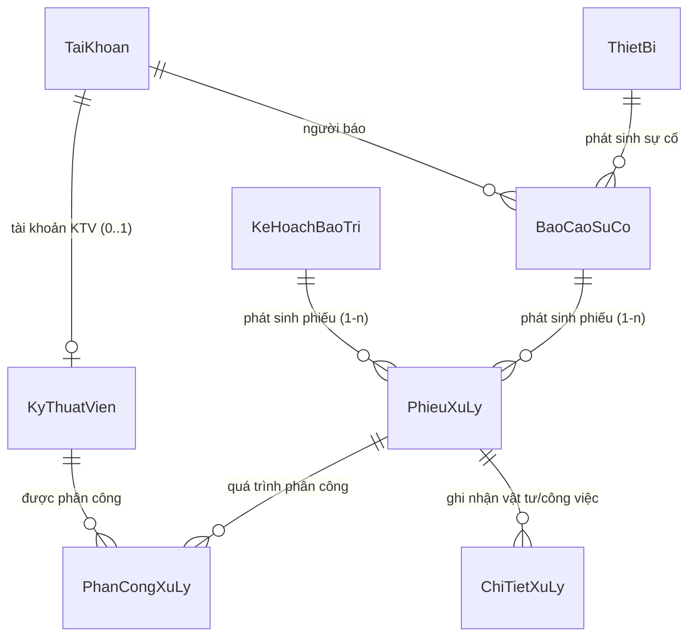

# BÁO CÁO BÀI TẬP LỚN & TÀI LIỆU BẢO VỆ ĐỒ ÁN — MODULE 4

* **Học phần:** Phát triển ứng dụng Web với ASP.NET Core & Entity Framework Core
* **Đề tài 16:** Hệ thống Quản lý Bảo trì Thiết bị và Xử lý Sự cố
* **Sinh viên thực hiện (SV4):** Trịnh Trung Hoàng
* **Mã sinh viên:** 23103100229
* **Lớp:** TI17A4HN
* **Module phụ trách chính:** **Module 4 — Báo cáo sự cố, Kỹ thuật viên, Phiếu xử lý, Phân công xử lý và Đổi KTV giữ lịch sử**

---

## MỤC LỤC
1. [TỔNG QUAN VÀ PHÂN TÍCH YÊU CẦU MODULE 4](#1-tổng-quan-và-phân-tích-yêu-cầu-module-4)
2. [THIẾT KẾ CƠ SỞ DỮ LIỆU & QUAN HỆ ENTITY](#2-thiết-kế-cơ-sở-dữ-liệu--quan-hệ-entity)
3. [KIẾN TRÚC MÃ NGUỒN & PATTERN TRIỂN KHAI](#3-kiến-trúc-mã-nguồn--pattern-triển-khai)
4. [CHI TIẾT CÁC CHỨC NĂNG NGHIỆP VỤ & MÃ NGUỒN QUAN TRỌNG](#4-chi-tiết-các-chức-năng-nghiệp-vụ--mã-nguồn-quan-trọng)
   * [4.1. Nghiệp vụ Báo cáo sự cố (BaoCaoSuCo)](#41-nghiệp-vụ-báo-cáo-sự-cố-baocaosuco)
   * [4.2. Nghiệp vụ Quản lý Kỹ thuật viên (KyThuatVien)](#42-nghiệp-vụ-quản-lý-kỹ-thuật-viên-kythuatvien)
   * [4.3. Nghiệp vụ Tạo Phiếu xử lý gắn đúng nguồn (PhieuXuLy)](#43-nghiệp-vụ-tạo-phiếu-xử-lý-gắn-đúng-nguồn-phieuxuly)
   * [4.4. Nghiệp vụ Phân công xử lý (PhanCongXuLy)](#44-nghiệp-vụ-phân-công-xử-lý-phancongxuly)
   * [4.5. Nghiệp vụ Đổi Kỹ thuật viên bảo toàn lịch sử & Xử lý Filtered Index](#45-nghiệp-vụ-đổi-kỹ-thuật-viên-bảo-toàn-lịch-sử--xử-lý-filtered-index)
   * [4.6. Nghiệp vụ Sự cố mức Cao/Khẩn cấp ảnh hưởng trạng thái thiết bị](#46-nghiệp-vụ-sự-cố-mức-caokhẩn-cấp-ảnh-hưởng-trạng-thái-thiết-bị)
   * [4.7. Nghiệp vụ Đính kèm ảnh hiện trường sự cố (Tệp đính kèm đa hình - STT 55)](#47-nghiệp-vụ-đính-kèm-ảnh-hiện-trường-sự-cố-tệp-đính-kèm-đa-hình---stt-55)
5. [CÁC CÂU TRUY VẤN LINQ TRỌNG TÂM](#5-các-câu-truy-vấn-linq-trọng-tâm)
6. [THIẾT KẾ GIAO DIỆN & PHÂN QUYỀN TRUY CẬP](#6-thiết-kế-giao-diện--phân-quyền-truy-cập)
7. [KỊCH BẢN BẢO VỆ VÀ TRẢ LỜI CÂU HỎI VẤN ĐÁP CÁ NHÂN (SV4)](#7-kịch-bản-bảo-vệ-và-trả-lời-câu-hỏi-vấn-đáp-cá-nhân-sv4)

---

## 1. TỔNG QUAN VÀ PHÂN TÍCH YÊU CẦU MODULE 4

Module 4 là mắt xích trung tâm kết nối giữa nhu cầu vận hành thiết bị thực tế (người dùng báo sự cố hoặc kế hoạch bảo trì định kỳ) với đội ngũ kỹ thuật viên thực thi bảo dưỡng, sửa chữa.

### Các nhiệm vụ trọng tâm theo Checklist đồ án (STT 7, 18, 19, 35, 36, 37, 38, 55):
1. **Quản lý Báo cáo sự cố:**
   * Cho phép người dùng gửi báo cáo sự cố gắn với thiết bị cụ thể trong khu vực.
   * Ngày báo cáo do hệ thống tự xác định (server timestamp), không cho người dùng nhập tay.
   * Phân quyền: Người dùng chỉ xem được báo cáo của mình (`CuaToi`); Admin xem toàn bộ báo cáo toàn cơ quan.
2. **Quản lý Hồ sơ Kỹ thuật viên:**
   * Quản lý danh sách KTV, chuyên môn, số điện thoại, email.
   * Ràng buộc tài khoản đăng nhập (1-0..1): 1 tài khoản chỉ gắn tối đa 1 hồ sơ KTV.
   * Xóa an toàn: KTV đã có lịch sử phân công công việc không được xóa vật lý, chỉ chuyển trạng thái ngừng hoạt động (`TrangThai = false`).
3. **Quản lý Phiếu xử lý (Phát sinh công việc):**
   * Phiếu xử lý có thể sinh ra từ 2 nguồn: Sự cố (`XuLySuCo`) hoặc Bảo trì định kỳ (`BaoTriDinhKy`).
   * Kiểm soát chặt chẽ ràng buộc toàn vẹn: Đúng một trong hai khóa ngoại `MaBaoCao` hoặc `MaKeHoach` có giá trị.
4. **Phân công và Đổi kỹ thuật viên bảo toàn lịch sử:**
   * Một phiếu xử lý chỉ có duy nhất 1 KTV phụ trách tại một thời điểm (`DangHieuLuc`).
   * Khi đổi KTV: **Không được sửa đè bản ghi cũ**. Kết thúc phân công cũ (chuyển sang `DaKetThuc` + lưu `NgayKetThucPhanCong`), tạo phân công mới với lý do bàn giao rõ ràng để bảo lưu 100% lịch sử.
   * Áp dụng LINQ để truy vấn KTV hiện tại và hiển thị bảng lịch sử bàn giao công việc.
5. **Quy tắc sự cố nghiêm trọng:**
   * Sự cố mức độ **Cao** hoặc **Khẩn cấp** tự động kích hoạt chuyển trạng thái thiết bị sang **Tạm ngừng do sự cố** (`TamNgungDoSuCo`) nhằm đảm bảo an toàn vận hành.
6. **Đính kèm ảnh hiện trường sự cố (Tính năng nâng cao STT 55):**
   * Cho phép tải lên nhiều ảnh chụp hiện trường khi báo sự cố hoặc bổ sung ảnh sau đó.
   * Xem trực tiếp ảnh hiện trường phóng to qua Lightbox trên cả trang Chi tiết sự cố và Phiếu xử lý.

---

## 2. THIẾT KẾ CƠ SỞ DỮ LIỆU & QUAN HỆ ENTITY

Module 4 chịu trách nhiệm quản lý trực tiếp 4 thực thể chính: `BaoCaoSuCo`, `KyThuatVien`, `PhieuXuLy`, `PhanCongXuLy`.



### 2.1. Chi tiết các bảng và cấu hình Fluent API trong `AppDbContext`

#### A. Thực thể `BaoCaoSuCo`
* Khóa chính: `MaBaoCao` (int, IDENTITY).
* Khóa ngoại:
  * `MaThietBi` -> `ThietBi(MaThietBi)`: Thiết bị gặp sự cố.
  * `MaTaiKhoanBaoCao` -> `TaiKhoan(MaTaiKhoan)`: Người gửi báo cáo.
* Cột nghiệp vụ: `NgayBaoCao` (DateTime), `MoTaSuCo` (nvarchar(500)), `MucDoSuCo` (Enum), `TrangThai` (Enum), `GhiChu` (nvarchar(500)).
* Constraint: `CK_BaoCao_TrangThai`, `CK_BaoCao_MucDo`.

#### B. Thực thể `KyThuatVien`
* Khóa chính: `MaKyThuatVien` (int, IDENTITY).
* Khóa ngoại: `MaTaiKhoan` -> `TaiKhoan(MaTaiKhoan)` (Nullable, Unique Index có điều kiện `WHERE MaTaiKhoan IS NOT NULL`).
* Cột nghiệp vụ: `HoTen` (nvarchar(100)), `ChuyenMon` (nvarchar(150)), `SoDienThoai` (nvarchar(15)), `Email` (nvarchar(100)), `TrangThai` (bit: `true` = Đang làm việc, `false` = Ngừng hoạt động).

#### C. Thực thể `PhieuXuLy`
* Khóa chính: `MaPhieuXuLy` (int, IDENTITY).
* Khóa ngoại 2 nguồn: `MaBaoCao` (Nullable) và `MaKeHoach` (Nullable).
* Ràng buộc toàn vẹn mức database (`CK_Phieu_Nguon`):
  ```sql
  ([LoaiXuLy] = 'XuLySuCo' AND [MaBaoCao] IS NOT NULL AND [MaKeHoach] IS NULL)
  OR ([LoaiXuLy] = 'BaoTriDinhKy' AND [MaKeHoach] IS NOT NULL AND [MaBaoCao] IS NULL)
  ```
* Ràng buộc trạng thái: `CK_Phieu_TrangThai`, `CK_Phieu_LoaiXuLy`.
* Thuộc tính động: `TongChiPhi` được tính bằng `SUM(ChiTietXuLy.ThanhTien)`, không lưu cột dư thừa.

#### D. Thực thể `PhanCongXuLy` (Bảo toàn lịch sử phân công)
* Khóa chính: `MaPhanCong` (int, IDENTITY).
* Khóa ngoại:
  * `MaPhieuXuLy` -> `PhieuXuLy(MaPhieuXuLy)`
  * `MaKyThuatVien` -> `KyThuatVien(MaKyThuatVien)`
* Cột thời gian & trạng thái: `NgayPhanCong`, `NgayKetThucPhanCong` (Nullable), `NoiDungPhanCong` (nvarchar(500)), `TrangThai` (Enum: `DangHieuLuc` / `DaKetThuc`).
* **Filtered Unique Index (`UX_PhanCong_DangHieuLuc`):**
  ```csharp
  modelBuilder.Entity<PhanCongXuLy>(e =>
  {
      e.HasIndex(x => x.MaPhieuXuLy).IsUnique()
       .HasFilter("[TrangThai] = 'DangHieuLuc'")
       .HasDatabaseName("UX_PhanCong_DangHieuLuc");
  });
  ```
  *Ý nghĩa:* Ràng buộc ở mức vật lý CSDL đảm bảo một phiếu xử lý **chỉ có thể tồn tại tối đa 1 kỹ thuật viên có trạng thái Đang hiệu lực**.

---

## 3. KIẾN TRÚC MÃ NGUỒN & PATTERN TRIỂN KHAI

Module 4 được thiết kế theo đúng quy chuẩn kiến trúc phân lớp hướng dịch vụ (**Repository & Service Pattern**), đảm bảo nguyên tắc Single Responsibility (SRP) và Separation of Concerns (SoC):

```
QuanLyBaoTriThietBi_UNETI01_TI17A4HN/
├── Models/
│   ├── BaoCaoSuCo.cs
│   ├── KyThuatVien.cs
│   ├── PhieuXuLy.cs
│   └── PhanCongXuLy.cs
├── ViewModels/
│   ├── BaoCaoSuCoViewModel.cs
│   ├── KyThuatVienViewModel.cs
│   └── PhieuXuLyViewModels.cs
├── Repositories/
│   ├── BaoCaoSuCo/ (IBaoCaoSuCoRepository & BaoCaoSuCoRepository)
│   ├── KyThuatVien/ (IKyThuatVienRepository & KyThuatVienRepository)
│   └── PhieuXuLy/ (IPhieuXuLyRepository & PhieuXuLyRepository)
├── Services/
│   ├── BaoCaoSuCo/ (IBaoCaoSuCoService & BaoCaoSuCoService)
│   ├── KyThuatVien/ (IKyThuatVienService & KyThuatVienService)
│   └── PhieuXuLy/ (IPhieuXuLyService & PhieuXuLyService)
├── Controllers/
│   ├── BaoCaoSuCo/BaoCaoSuCoController.cs
│   ├── KyThuatVien/KyThuatVienController.cs
│   └── PhieuXuLy/PhieuXuLyController.cs
└── Views/
    ├── BaoCaoSuCo/ (Index, Details, Create, Edit, _Form)
    ├── KyThuatVien/ (Index, Create, Edit, _Form)
    └── PhieuXuLy/ (Index, Details, Create, ViecCuaToi)
```

* **Dependency Injection:** Tự động quét và đăng ký interface và implementation qua extension `AddRepositoriesAndServices()`.
* **Kết quả xử lý:** Sử dụng `ServiceResult` và `ServiceResult<T>` để đóng gói kết quả, kiểm soát lỗi nghiệp vụ không ném Exception lung tung ra ngoài Controller.

---

## 4. CHI TIẾT CÁC CHỨC NĂNG NGHIỆP VỤ & MÃ NGUỒN QUAN TRỌNG

### 4.1. Nghiệp vụ Báo cáo sự cố (BaoCaoSuCo)
* **Gửi báo cáo:** Người dùng chọn thiết bị, mô tả sự cố và mức độ (Thấp, Trung bình, Cao, Khẩn cấp).
* **Kiểm tra nghiệp vụ:**
  * Thiết bị phải tồn tại và chưa bị đưa vào danh sách `NgungSuDung`.
  * `NgayBaoCao` được gán cố định bằng `DateTime.Now` phía server.
  * Trạng thái khởi tạo luôn là `MoiBao`.
* **Phân quyền và bảo mật:**
  * Action `CuaToi`: Chỉ lọc các báo cáo có `MaTaiKhoanBaoCao == User.MaTaiKhoan`.
  * Action `Index`: Chỉ có quyền `Admin` mới được xem toàn bộ danh sách báo cáo.

### 4.2. Nghiệp vụ Quản lý Kỹ thuật viên (KyThuatVien)
* **Validation dữ liệu:**
  * Định dạng số điện thoại bằng Regex: `^(\+84|0)\d{9,10}$`.
  * Email hợp lệ và kiểm tra chống trùng lặp trong hệ thống (`EmailDaTonTaiAsync`).
  * Tài khoản liên kết phải có vai trò `KyThuatVien` và chưa từng gán cho KTV khác.
* **Quy tắc xóa an toàn (Safe Delete):**
  ```csharp
  // Kiểm tra lịch sử trước khi xóa
  var coPhanCong = await _repo.DemPhanCongAsync(id, chiDangHieuLuc: false);
  if (coPhanCong > 0)
  {
      return ServiceResult.Fail("Kỹ thuật viên đã từng được phân công công việc, không thể xóa vật lý. Hãy chuyển sang Ngừng hoạt động để bảo lưu lịch sử.");
  }
  ```

### 4.3. Nghiệp vụ Tạo Phiếu xử lý gắn đúng nguồn (PhieuXuLy)
* **Nguyên tắc tạo:**
  * Nếu chọn `XuLySuCo`: Bắt buộc nhập `MaBaoCao` hợp lệ; `MaKeHoach` phải là `null`. Kiểm tra báo cáo chưa bị hủy và chưa có phiếu xử lý nào đang hoạt động.
  * Nếu chọn `BaoTriDinhKy`: Bắt buộc nhập `MaKeHoach` hợp lệ; `MaBaoCao` phải là `null`. Kiểm tra kế hoạch chưa hoàn thành/hủy và chưa có phiếu xử lý đang hoạt động.
* **Xử lý trạng thái phiếu:**
  * Nếu có chọn KTV ngay lúc tạo: Trạng thái phiếu là `DaPhanCong`.
  * Nếu chưa chọn KTV: Trạng thái phiếu là `ChoPhanCong`.

### 4.4. Nghiệp vụ Phân công xử lý (PhanCongXuLy)
* **Kiểm tra tính hợp lệ:**
  * Phiếu phải ở trạng thái cho phép phân công (chưa `HoanThanh` hoặc `DaHuy`).
  * KTV được phân công phải đang hoạt động (`TrangThai == true`). CSDL và DbContext có thêm tầng phòng thủ `ValidateAssignmentsAsync` chặn việc gán KTV đã nghỉ việc.
  * Kiểm tra không có 2 phân công đang hiệu lực đồng thời.
  * Cập nhật trạng thái phiếu từ `ChoPhanCong` -> `DaPhanCong`.

### 4.5. Nghiệp vụ Đổi Kỹ thuật viên bảo toàn lịch sử & Xử lý Filtered Index
* **Vấn đề kỹ thuật:**
  * CSDL có Filtered Unique Index `UX_PhanCong_DangHieuLuc` trên cột `MaPhieuXuLy` với điều kiện `[TrangThai] = 'DangHieuLuc'`.
  * Nếu thực hiện đồng thời sửa bản ghi cũ và insert bản ghi mới trong cùng 1 transaction/SaveChanges mà không tách thứ tự, EF Core có thể phát lệnh INSERT trước UPDATE, dẫn đến vi phạm Unique Index.
* **Giải pháp tối ưu đã thực hiện:**
  ```csharp
  // 1. Kết thúc phân công cũ
  var phanCongCu = await _phieuRepo.LayPhanCongHienTaiAsync(model.MaPhieuXuLy);
  if (phanCongCu != null)
  {
      if (phanCongCu.MaKyThuatVien == model.MaKyThuatVienMoi.Value)
          return ServiceResult.Fail("Kỹ thuật viên này hiện đang phụ trách phiếu rồi, không cần đổi.");

      phanCongCu.TrangThai = TrangThaiPhanCongEnum.DaKetThuc;
      phanCongCu.NgayKetThucPhanCong = DateTime.Now;

      // BẮT BUỘC SaveChanges trước để giải phóng unique index UX_PhanCong_DangHieuLuc
      await _context.SaveChangesAsync();
  }

  // 2. Tạo phân công mới với trạng thái DangHieuLuc
  var phanCongMoi = new PhanCongXuLy
  {
      MaPhieuXuLy = model.MaPhieuXuLy,
      MaKyThuatVien = model.MaKyThuatVienMoi.Value,
      NgayPhanCong = DateTime.Now,
      TrangThai = TrangThaiPhanCongEnum.DangHieuLuc,
      NoiDungPhanCong = $"[Đổi KTV] {model.LyDoDoi.Trim()}"
  };

  await _phieuRepo.ThemPhanCongAsync(phanCongMoi);
  await _phieuRepo.SaveChangesAsync();
  ```

### 4.6. Nghiệp vụ Sự cố mức Cao/Khẩn cấp ảnh hưởng trạng thái thiết bị
* Để bảo đảm an toàn vận hành, khi sự cố ở mức `Cao` hoặc `KhanCap`, hệ thống can thiệp vào vòng đời thiết bị:
  ```csharp
  bool laSuCoNghiemTrong = bc.MucDoSuCo == MucDoSuCoEnum.Cao || bc.MucDoSuCo == MucDoSuCoEnum.KhanCap;
  if (model.TamNgungThietBi || laSuCoNghiemTrong)
  {
      if (bc.ThietBi != null && bc.ThietBi.TinhTrang == TinhTrangThietBiEnum.DangHoatDong)
      {
          bc.ThietBi.TinhTrang = TinhTrangThietBiEnum.TamNgungDoSuCo;
      }
  }
  ```


### 4.7. Nghiệp vụ Đính kèm ảnh hiện trường sự cố (Tệp đính kèm đa hình - STT 55)
* **Ý nghĩa thực tế:**
  * Khi người sử dụng phát hiện sự cố, ngoài việc mô tả văn bản, việc gửi kèm hình ảnh chụp hiện trường (hỏng hóc, chập cháy, nứt vỡ...) giúp Kỹ thuật viên và Admin nhanh chóng nắm bắt chính xác hiện trạng mà không cần phải khảo sát sơ bộ.
  * Khi lập phiếu xử lý sự cố (`XuLySuCo`), KTV được phân công có thể xem trực quan ảnh hiện trường ngay trên trang Chi tiết Phiếu xử lý (`PhieuXuLy/Details`) để chủ động chuẩn bị dụng cụ, vật tư thay thế phù hợp trước khi đến hiện trường.
* **Cơ chế triển khai hạ tầng Tệp đính kèm đa hình (Polymorphic Attachment):**
  * Sử dụng bảng `TepDinhKem` chung cho toàn hệ thống với cặp trường định danh đa hình: `LoaiDoiTuong` (`LoaiDoiTuongDinhKemEnum.BaoCaoSuCo`) và `MaDoiTuong` (`MaBaoCao`).
  * Tích hợp `ITepDinhKemService` vào `BaoCaoSuCoService` và `BaoCaoSuCoController` để xử lý upload nhiều ảnh đồng thời khi người dùng gửi báo cáo (`Create`), cập nhật báo cáo (`Edit`), hoặc tải bổ sung ảnh ngay tại trang chi tiết (`Details`).
  * Tệp ảnh được lưu trữ an toàn tại thư mục vật lý `wwwroot/uploads/baocaosuco/`, tên file được sinh ngẫu nhiên bằng GUID để chống tấn công ghi đè hoặc xung đột tên file.
  * Kiểm duyệt định dạng nghiêm ngặt (`chiChapNhanAnh: true`): chỉ chấp nhận các định dạng ảnh hợp lệ (`.jpg`, `.jpeg`, `.png`, `.gif`, `.webp`), kích thước tối đa 10MB/ảnh.
* **Tích hợp hiển thị và tương tác người dùng:**
  * **Trang Báo cáo sự cố (`BaoCaoSuCo/Details`):** Hiển thị Gallery ảnh lưới (Grid), hỗ trợ click xem ảnh phóng to toàn màn hình qua Modal Lightbox, hiển thị thông tin dung lượng, người tải lên, thời gian tải lên. Hỗ trợ nút xóa ảnh trực quan có xác nhận an toàn (chỉ Admin hoặc chính người tạo báo cáo khi còn ở trạng thái `MoiBao` mới có quyền xóa).
  * **Trang Phiếu xử lý (`PhieuXuLy/Details`):** Khi phiếu thuộc loại `XuLySuCo`, hệ thống tự động truy vấn danh sách ảnh hiện trường từ `MaBaoCao` liên kết và hiển thị trực tiếp trong thẻ thông tin nguồn công việc, kèm Modal Lightbox xem chi tiết.

---

## 5. CÁC CÂU TRUY VẤN LINQ TRỌNG TÂM

### 5.1. LINQ lấy Kỹ thuật viên đang phụ trách hiện tại của một phiếu (STT 36)
```csharp
public Task<KyThuatVien?> LayKtvHienTaiAsync(int maPhieuXuLy) =>
    _context.PhanCongXuLys
        .AsNoTracking()
        .Where(pc => pc.MaPhieuXuLy == maPhieuXuLy && pc.TrangThai == TrangThaiPhanCongEnum.DangHieuLuc)
        .Select(pc => pc.KyThuatVien)
        .FirstOrDefaultAsync();
```
*Tối ưu hóa:* Sử dụng `.AsNoTracking()` và toán tử `.Select()` giúp SQL Server sinh mã `SELECT TOP(1)` kèm `INNER JOIN` chỉ lấy đúng các cột cần thiết của bảng `KyThuatVien`, không tải dư thừa các cột trung gian của `PhanCongXuLy`.

### 5.2. LINQ lấy toàn bộ Lịch sử phân công theo phiếu xử lý
```csharp
public async Task<List<PhanCongXuLyLichSuRow>> LayLichSuPhanCongAsync(int maPhieuXuLy) =>
    await _context.PhanCongXuLys
        .AsNoTracking()
        .Where(pc => pc.MaPhieuXuLy == maPhieuXuLy)
        .OrderByDescending(pc => pc.NgayPhanCong)
        .ThenByDescending(pc => pc.MaPhanCong)
        .Select(pc => new PhanCongXuLyLichSuRow(
            pc.MaPhanCong,
            pc.MaKyThuatVien,
            pc.KyThuatVien!.HoTen,
            pc.KyThuatVien.ChuyenMon,
            pc.KyThuatVien.SoDienThoai,
            pc.KyThuatVien.Email,
            pc.NgayPhanCong,
            pc.NgayKetThucPhanCong,
            pc.NoiDungPhanCong,
            pc.TrangThai
        ))
        .ToListAsync();
```

### 5.3. LINQ Tìm kiếm, Lọc nhiều tiêu chí và Phân trang (Search-Filter-Sort-Pagination)
* Thứ tự chuẩn: **Where (Lọc) -> OrderBy (Sắp xếp) -> Skip -> Take (Phân trang)**.
* Tính `TongChiPhi` động trên phiếu bằng LINQ `.Sum(c => c.ThanhTien ?? 0m)`:
```csharp
var query = _context.PhieuXuLys.AsNoTracking();

// 1. Where: Lọc theo Loại, Trạng thái, Khoảng ngày, KTV, Từ khóa
if (boLoc.LoaiXuLy.HasValue)
    query = query.Where(p => p.LoaiXuLy == boLoc.LoaiXuLy.Value);

if (boLoc.TrangThai.HasValue)
    query = query.Where(p => p.TrangThai == boLoc.TrangThai.Value);

if (boLoc.MaKyThuatVien.HasValue)
    query = query.Where(p => p.PhanCongXuLys.Any(pc =>
        pc.MaKyThuatVien == boLoc.MaKyThuatVien.Value && pc.TrangThai == TrangThaiPhanCongEnum.DangHieuLuc));

// 2. Phân trang bằng Skip/Take
var rawList = await query
    .OrderByDescending(p => p.NgayTao)
    .Skip((page - 1) * pageSize)
    .Take(pageSize)
    .Select(p => new {
        p.MaPhieuXuLy,
        p.LoaiXuLy,
        p.TrangThai,
        TenThietBi = p.LoaiXuLy == LoaiXuLyEnum.XuLySuCo ? p.BaoCaoSuCo!.ThietBi!.TenThietBi : p.KeHoachBaoTri!.ThietBi!.TenThietBi,
        PhanCongHienTai = p.PhanCongXuLys.Where(pc => pc.TrangThai == TrangThaiPhanCongEnum.DangHieuLuc)
                                          .Select(pc => pc.KyThuatVien!.HoTen).FirstOrDefault(),
        TongChiPhi = p.ChiTietXuLys.Sum(c => c.ThanhTien ?? 0m)
    })
    .ToListAsync();
```

---

## 6. THIẾT KẾ GIAO DIỆN & PHÂN QUYỀN TRUY CẬP

### 6.1. Ma trận phân quyền tại Controller (`[Authorize]`)
| Controller / Action | Admin | Kỹ thuật viên | Người sử dụng | Ghi chú |
| :--- | :---: | :---: | :---: | :--- |
| `BaoCaoSuCo/Create` | ✔️ | ✔️ | ✔️ | Ai cũng có thể gửi báo cáo sự cố khi phát hiện |
| `BaoCaoSuCo/CuaToi` | ✔️ | ✔️ | ✔️ | Người dùng xem danh sách báo cáo do chính mình tạo |
| `BaoCaoSuCo/Index` (Toàn bộ) | ✔️ | ❌ | ❌ | Chỉ Admin xem và kiểm soát tất cả sự cố |
| `KyThuatVien/Index, Create, Edit` | ✔️ | ❌ | ❌ | Chỉ Admin quản lý danh mục hồ sơ kỹ thuật viên |
| `PhieuXuLy/Index` (Toàn bộ) | ✔️ | ✔️ | ❌ | Admin & KTV xem danh sách phiếu |
| `PhieuXuLy/ViecCuaToi` | ❌ | ✔️ | ❌ | Màn hình riêng cho KTV theo dõi công việc của mình |
| `PhieuXuLy/Create, PhanCong, DoiKtv, Huy` | ✔️ | ❌ | ❌ | Chỉ Admin được quyền điều phối và phân công công việc |

### 6.2. Các màn hình giao diện đã hoàn thiện
* **`Views/PhieuXuLy/Index.cshtml`:** Bảng danh sách phiếu xử lý kèm form bộ lọc đa năng, hiển thị huy hiệu trạng thái, tên KTV phụ trách hiện tại, chi phí vật tư và phân trang thân thiện.
* **`Views/PhieuXuLy/ViecCuaToi.cshtml`:** Giao diện tối ưu cho KTV đăng nhập xem ngay các phiếu mình đang đảm nhiệm.
* **`Views/PhieuXuLy/Details.cshtml`:** Trang chi tiết thông tin phiếu, thẻ hiển thị KTV phụ trách, thông tin thiết bị, modal phân công KTV và **modal Đổi KTV bảo toàn lịch sử bàn giao**.
* **`Views/PhieuXuLy/Create.cshtml`:** Form tạo phiếu tự động chuyển đổi giữa nguồn Báo cáo sự cố và Kế hoạch bảo trì bằng Javascript, tích hợp tùy chọn chuyển trạng thái thiết bị sang Tạm ngừng do sự cố.

---

## 7. KỊCH BẢN BẢO VỆ VÀ TRẢ LỜI CÂU HỎI VẤN ĐÁP CÁ NHÂN (SV4)

Dưới đây là các câu hỏi trọng tâm giảng viên thường hỏi sinh viên phụ trách Module 4 và hướng trả lời chuẩn xác:

### Câu 1: Tại sao trong bảng `PhieuXuLy` em lại để cả hai khóa ngoại `MaBaoCao` và `MaKeHoach` đều là Nullable? Làm sao để không bị trường hợp cả 2 cùng có dữ liệu hoặc cả 2 cùng rỗng?
* **Trả lời:**
  * Theo nghiệp vụ đề bài, Phiếu xử lý là nơi thực thi công việc bắt nguồn từ một trong hai nghiệp vụ: hoặc là xử lý một **Báo cáo sự cố** đột xuất, hoặc là tiến hành **Bảo trì định kỳ** theo kế hoạch có sẵn.
  * Vì vậy, mỗi phiếu chỉ được phép liên kết tới đúng một nguồn. Nếu phiếu là `XuLySuCo` thì `MaBaoCao` có giá trị và `MaKeHoach` phải là `NULL`; ngược lại nếu là `BaoTriDinhKy` thì `MaKeHoach` có giá trị và `MaBaoCao` phải là `NULL`.
  * Em kiểm soát ràng buộc này ở 2 tầng:
    1. **Tầng CSDL (Database):** Cấu hình Check Constraint `CK_Phieu_Nguon` trong EF Core qua Fluent API: `([LoaiXuLy] = 'XuLySuCo' AND [MaBaoCao] IS NOT NULL AND [MaKeHoach] IS NULL) OR ([LoaiXuLy] = 'BaoTriDinhKy' AND [MaKeHoach] IS NOT NULL AND [MaBaoCao] IS NULL)`.
    2. **Tầng Ứng dụng (Service):** Trong hàm `TaoPhieuXuLyAsync`, em validate chặt chẽ nguồn dữ liệu trước khi thêm vào context để thông báo lỗi thân thiện cho người dùng.

### Câu 2: Trình bày cơ chế đổi kỹ thuật viên mà không làm mất lịch sử phân công công việc? Em xử lý Filtered Index như thế nào?
* **Trả lời:**
  * Em thiết kế bảng trung gian `PhanCongXuLy` gồm khóa ngoại `MaPhieuXuLy`, `MaKyThuatVien`, cột thời gian `NgayPhanCong`, `NgayKetThucPhanCong` và trạng thái `TrangThai` (`DangHieuLuc` / `DaKetThuc`).
  * Khi đổi KTV: Em **không dùng lệnh Update đè** mã KTV cũ. Thay vào đó, em lấy bản ghi phân công cũ đang có trạng thái `DangHieuLuc`, cập nhật `TrangThai = DaKetThuc` và gán `NgayKetThucPhanCong = DateTime.Now`.
  * **Xử lý Filtered Unique Index:** Database có ràng buộc `UX_PhanCong_DangHieuLuc` chỉ cho phép duy nhất 1 bản ghi `DangHieuLuc` cho mỗi `MaPhieuXuLy`. Vì vậy, em bắt buộc gọi `await _context.SaveChangesAsync()` ngay sau khi kết thúc phân công cũ để DB cập nhật xong, sau đó mới tạo bản ghi `PhanCongXuLy` mới với KTV mới, trạng thái `DangHieuLuc`, kèm lý do bàn giao và gọi `SaveChangesAsync()` lần hai.

### Câu 3: Làm thế nào để lấy ra Kỹ thuật viên đang phụ trách hiện tại của một phiếu bằng LINQ?
* **Trả lời:**
  * Em truy vấn từ DbSet `PhanCongXuLys`, lọc theo `MaPhieuXuLy` và điều kiện `TrangThai == TrangThaiPhanCongEnum.DangHieuLuc`, sau đó dùng `.Select(pc => pc.KyThuatVien).FirstOrDefaultAsync()`.
  * Nhờ cấu hình quan hệ Navigation Property và dùng toán tử `.Select()`, Entity Framework Core sẽ tự động chuyển thành câu lệnh SQL với mệnh đề `INNER JOIN` và `WHERE PhanCongXuLy.TrangThai = 'DangHieuLuc'`, chỉ lấy thông tin của KTV đang trực tiếp thụ lý công việc.

### Câu 4: Khi nào thiết bị được chuyển sang trạng thái "Tạm ngừng do sự cố"?
* **Trả lời:**
  * Khi người dùng gửi báo cáo sự cố ở mức độ nghiêm trọng (**Cao** hoặc **Khẩn cấp**), khi Admin lập phiếu xử lý sự cố, hệ thống sẽ tự động kích hoạt cập nhật trạng thái của thiết bị từ `DangHoatDong` sang `TamNgungDoSuCo`.
  * Việc này nhằm ngăn chặn các bộ phận khác tiếp tục vận hành thiết bị đang gặp sự cố nguy hiểm, đồng thời cảnh báo rõ ràng trên toàn bộ giao diện quản trị thiết bị cho đến khi KTV nghiệm thu hoàn thành sửa chữa.

### Câu 5: Tại sao trong bảng `KyThuatVien` có trường `TrangThai` kiểu bool mà không xóa hẳn khi KTV nghỉ việc?
* **Trả lời:**
  * Đây là nguyên tắc **Xóa mềm (Soft Delete)** nhằm bảo đảm tính toàn vẹn tham chiếu của cơ sở dữ liệu.
  * Nếu một KTV đã từng tham gia xử lý các phiếu sửa chữa trong quá khứ, việc xóa vật lý bản ghi KTV sẽ dẫn đến lỗi vi phạm khóa ngoại ở bảng `PhanCongXuLy` hoặc làm mất lịch sử bảo trì của thiết bị.
  * Do đó, hệ thống chỉ chuyển `TrangThai = false` (Ngừng hoạt động). Khi KTV đã ngừng hoạt động, hệ thống sẽ lọc bỏ KTV này ra khỏi danh sách phân công mới (`LayDangHoatDongAsync`), đồng thời kích hoạt kiểm tra chặn ở DbContext (`ValidateAssignmentsAsync`).


### Câu 6: Tính năng đính kèm ảnh hiện trường sự cố (STT 55) được em thiết kế và bảo vệ như thế nào?
* **Trả lời:**
  * **Về mô hình dữ liệu:** Em áp dụng mô hình liên kết tệp đính kèm đa hình (Polymorphic Attachment) qua bảng `TepDinhKem` dùng chung với khóa ngoại mềm `(LoaiDoiTuong = 'BaoCaoSuCo', MaDoiTuong = MaBaoCao)`. Cách làm này giúp bảng `BaoCaoSuCo` không bị phình to các cột ảnh tĩnh và cho phép một báo cáo có thể đính kèm nhiều ảnh hiện trường linh hoạt.
  * **Về tính toàn vẹn và dọn dẹp dữ liệu:** Khi xóa một báo cáo sự cố trong `BaoCaoSuCoService.XoaAsync`, em gọi `_tepDinhKemService.XoaToanBoTheoDoiTuongAsync(...)` để xóa triệt để cả bản ghi trong CSDL lẫn file vật lý trong thư mục `wwwroot/uploads/baocaosuco/`, tránh tình trạng "tệp mồ côi" (orphan files) làm đầy ổ cứng máy chủ.
  * **Về bảo mật và phân quyền:**
    1. Kiểm duyệt loại file: Chỉ chấp nhận các đuôi mở rộng ảnh an toàn (`.jpg`, `.jpeg`, `.png`, `.webp`, `.gif`), chặn đứng nguy cơ tải lên các file mã thực thi độc hại (`.exe`, `.php`, `.aspx`).
    2. Đổi tên file vật lý bằng GUID để tránh path traversal và trùng lặp.
    3. Phân quyền xóa ảnh: Chỉ tài khoản `Admin` hoặc chính người gửi báo cáo lúc sự cố còn ở trạng thái `MoiBao` mới có quyền xóa ảnh; khi đã có KTV tiếp nhận xử lý thì dữ liệu ảnh hiện trường được bảo toàn nguyên vẹn làm bằng chứng.

---
### Câu 7: Khi một Phiếu xử lý được chuyển sang trạng thái "Hoàn thành" hoặc "Đã hủy", trạng thái của Báo cáo sự cố và Thiết bị được cập nhật như thế nào?
* **Trả lời:**
  * **Khi Phiếu xử lý "Hoàn thành" (`HoanThanh`):**
    * Nếu phiếu bắt nguồn từ Báo cáo sự cố (`XuLySuCo`): Báo cáo sự cố tương ứng sẽ được tự động chuyển trạng thái từ `DangXuLy` sang `DaXuLy`.
    * Thiết bị liên quan: Nếu trước đó đang ở trạng thái `TamNgungDoSuCo`, hệ thống sẽ phục hồi trạng thái của thiết bị trở lại `DangHoatDong`, cho phép đưa vào khai thác sử dụng bình thường.
    * Cập nhật thời điểm `NgayHoanThanh = DateTime.Now` trên phiếu xử lý.
  * **Khi Phiếu xử lý bị "Đã hủy" (`DaHuy`):**
    * Phân công đang hiệu lực của KTV sẽ được kết thúc.
    * Báo cáo sự cố liên kết được trả về trạng thái ban đầu (`MoiBao`) hoặc đánh dấu hủy tùy theo nguyên nhân hủy phiếu, cho phép người quản trị có thể xem xét lập phiếu xử lý khác thay thế.
    * Toàn bộ các thao tác chuyển đổi trạng thái này đều được kiểm soát trong Service layer nhằm đảm bảo tính nhất quán dữ liệu trên toàn bộ các phân hệ của MaintainPro.

---
*Hà Nội, Ngày 09 tháng 11 năm 2026*  
**Sinh viên thực hiện & Báo cáo viên:**  
**Trịnh Trung Hoàng**  
*(Mã sinh viên: 23103100229 — Lớp: TI17A4HN)*

