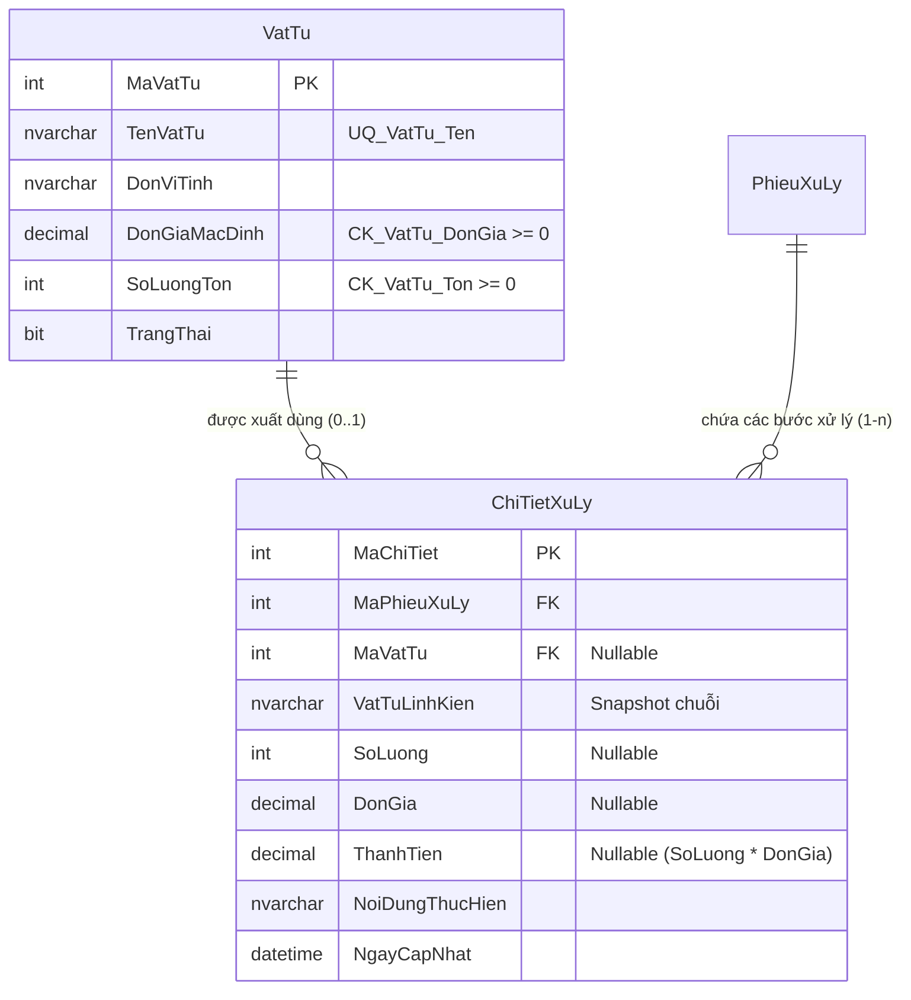

# BÁO CÁO NGHIỆP VỤ & TÀI LIỆU BẢO VỆ ĐỒ ÁN — MODULE 5 (STT 57 & STT 58)

* **Học phần:** Phát triển ứng dụng Web với ASP.NET Core & Entity Framework Core
* **Đề tài 16:** Hệ thống Quản lý Bảo trì Thiết bị và Xử lý Sự cố
* **Sinh viên thực hiện (SV5):** Nguyễn Khắc Hiếu
* **Mã sinh viên:** 23103100225
* **Lớp:** TI17A4HN
* **Module phụ trách chính:** **Module 5 — Cập nhật xử lý, Nghiệm thu, Chi phí, Lịch sử thiết bị, Dashboard & Kho vật tư (STT 57, 58)**

---

## 1. TỔNG QUAN YÊU CẦU STT 57 & STT 58

Căn cứ theo tài liệu **`THIETKE.md` (Mục 1, Mục 2.1, Mục 6.5 và Mục 25)** cùng bảng **Checklist nâng cao `KE_HOACH_NANG_CAO.md`**:

1. **STT 57 — Quản lý danh mục Kho vật tư (`VatTu`):**
   * Chuẩn hóa danh mục vật tư, linh kiện thay thế thay vì chỉ cho phép nhập chuỗi tự do.
   * Quản lý các thông tin: Tên vật tư, Đơn vị tính (ĐVT), Đơn giá mặc định gợi ý, Số lượng tồn kho, Trạng thái (Đang sử dụng / Ngừng sử dụng).
   * **Cảnh báo tồn kho đa cấp độ:**
     * ❌ **Hết hàng:** Số lượng tồn kho $= 0$.
     * ⚠️ **Sắp hết hàng:** Số lượng tồn kho $> 0$ và $\le 5$ đơn vị.
     * ✅ **An toàn:** Số lượng tồn kho $> 5$ đơn vị.
   * Thống kê nhanh: Tổng số loại vật tư, số loại sắp hết, số loại đã hết hàng, tổng giá trị tồn kho quy đổi thành tiền.
   * Hỗ trợ tìm kiếm, lọc theo mức tồn kho, trạng thái sử dụng, phân trang và **xuất báo cáo Excel chuyên nghiệp** qua `ExcelExportHelper` (STT 61).
   * **Quy tắc xóa an toàn (Safe Delete):** Vật tư đã từng được xuất dùng trong bất kỳ phiếu sửa chữa nào (`ChiTietXuLy`) thì **tuyệt đối không được xóa vật lý**, hệ thống sẽ chặn lại và yêu cầu chuyển sang *Ngừng sử dụng* để bảo toàn tính toàn vẹn tham chiếu.

2. **STT 58 — Tích hợp xuất kho và Snapshot bảo toàn lịch sử:**
   * **Trừ kho tự động khi xuất dùng:** Khi Kỹ thuật viên / Admin thêm bước xử lý (`ThemAsync`), chọn vật tư từ kho:
     * Kiểm tra số lượng tồn kho: nếu không đủ thì báo lỗi rõ ràng.
     * Tự động trừ tồn kho: `vt.SoLuongTon -= vm.SoLuong`.
     * **Snapshot tên vật tư:** Tự động copy tên vật tư vào cột `VatTuLinhKien` dạng chuỗi độc lập.
   * **Điều chỉnh tồn kho khi sửa bước xử lý (`SuaAsync`):**
     * Giữ nguyên vật tư: bù trừ theo chênh lệch số lượng (`chenhLech = slMoi - slCu`).
     * Đổi sang vật tư khác: hoàn lại số lượng cũ cho vật tư cũ, trừ số lượng mới từ vật tư mới.
   * **Hoàn trả kho khi xóa bước xử lý (`XoaAsync`):**
     * Khi phiếu đang xử lý và xóa một bước có vật tư kho: hệ thống tự động cộng hoàn trả lại số lượng tồn kho `vt.SoLuongTon += ct.SoLuong`.
   * **Nguyên tắc "Bảo toàn lịch sử 100%":** Dù sau này vật tư trong kho có đổi tên, đổi giá hay bị xóa/ngừng dùng thì các phiếu xử lý trong quá khứ vẫn giữ nguyên tên vật tư (nhờ snapshot chuỗi `VatTuLinhKien`), đơn giá và thành tiền ban đầu.

---

## 2. THIẾT KẾ CƠ SỞ DỮ LIỆU & QUAN HỆ ENTITY



### Ràng buộc toàn vẹn & Index trong `AppDbContext`
* **Unique Index:** `UQ_VatTu_Ten` trên cột `TenVatTu` chống trùng tên vật tư.
* **Check Constraint:** `CK_VatTu_DonGia` (`[DonGiaMacDinh] >= 0`) và `CK_VatTu_Ton` (`[SoLuongTon] >= 0`).
* **Foreign Key:** `ChiTietXuLy.MaVatTu` trỏ tới `VatTu.MaVatTu` (Nullable).

---

## 3. KIẾN TRÚC MÃ NGUỒN TRIỂN KHAI

Tuân thủ nghiêm ngặt **Repository & Service Pattern**:

```
QuanLyBaoTriThietBi_UNETI01_TI17A4HN/
├── Models/
│   ├── VatTu.cs (Entity chính)
│   └── ChiTietXuLy.cs (Liên kết MaVatTu + snapshot VatTuLinhKien)
├── ViewModels/
│   ├── VatTuViewModels.cs (VatTuItemViewModel, VatTuFormViewModel, VatTuFilterViewModel, VatTuIndexViewModel)
│   └── ChiTietXuLyViewModels.cs (VatTuLuaChon bổ sung SoLuongTon)
├── Repositories/
│   ├── VatTu/ (IVatTuRepository & VatTuRepository)
│   └── ChiTietXuLy/ (Bổ sung LayVatTuTrackingAsync, LayVatTuChoChonAsync có tồn kho)
├── Services/
│   ├── VatTu/ (IVatTuService & VatTuService - CRUD, kiểm tra tồn kho, xuất Excel)
│   └── ChiTietXuLy/ (ChiTietXuLyService - Trừ/hoàn kho tự động, snapshot lịch sử)
├── Controllers/
│   └── VatTu/VatTuController.cs (Phân quyền Admin/KTV, CRUD, ChuyenTrangThai, XuatExcel)
└── Views/
    ├── VatTu/ (Index.cshtml, Create.cshtml, Edit.cshtml, _Form.cshtml)
    └── ChiTietXuLy/ (_Form.cshtml và _FormScripts.cshtml hiển thị badge cảnh báo tồn kho thời gian thực)
```

---

## 4. KỊCH BẢN VẤN ĐÁP BẢO VỆ ĐỒ ÁN (DÀNH CHO SV5 - NGUYỄN KHẮC HIẾU)

### Câu 1: Tại sao trong bảng `ChiTietXuLy` đã có khóa ngoại `MaVatTu` trỏ sang bảng `VatTu` rồi mà em vẫn giữ lại cột chuỗi `VatTuLinhKien`?
* **Trả lời:**
  * Đây là yêu cầu cốt lõi về **Bảo toàn lịch sử (Historical Preservation)** của đề bài.
  * Nếu hệ thống chỉ lưu `MaVatTu`, khi sau này quản trị viên đổi tên vật tư (ví dụ từ *SSD 256GB* thành *SSD 512GB*) hoặc xóa/ngừng dùng vật tư đó, toàn bộ các phiếu xử lý bảo trì từ các năm trước sẽ bị hiển thị sai lệch theo tên mới.
  * Vì vậy, khi kỹ thuật viên chọn vật tư trong kho, hệ thống thực hiện **Snapshot** giá trị `TenVatTu` tại thời điểm đó vào cột `VatTuLinhKien`. Điều này đảm bảo biên bản nghiệm thu và lịch sử bảo trì trong quá khứ là bất biến, không bao giờ bị sai lệch dữ liệu.

### Câu 2: Em xử lý nghiệp vụ trừ kho và hoàn kho như thế nào? Tại sao lại làm ở Service layer mà không viết Trigger trong SQL Server?
* **Trả lời:**
  * Em triển khai trừ/hoàn kho tại tầng **Service Layer (`ChiTietXuLyService`)**:
    1. **Khi thêm mới (`ThemAsync`):** Kiểm tra `vt.SoLuongTon >= vm.SoLuong`, nếu đủ thì trừ kho `vt.SoLuongTon -= vm.SoLuong` và lưu vào DB trong cùng transaction `SaveChangesAsync()`.
    2. **Khi chỉnh sửa (`SuaAsync`):** Tính toán độ lệch số lượng để bù trừ kho, hoặc nếu đổi sang vật tư khác thì hoàn lại số lượng cũ cho vật tư cũ và trừ số lượng mới từ vật tư mới.
    3. **Khi xóa (`XoaAsync`):** Tự động hoàn trả tồn kho `vt.SoLuongTon += ct.SoLuong`.
  * **Lý do không dùng Trigger:**
    * Viết ở Service layer giúp code C# minh bạch, dễ unit test, dễ debug và kiểm soát thông báo lỗi thân thiện cho người dùng (ví dụ: hiển thị chính xác còn thiếu bao nhiêu sản phẩm).
    * Giúp cơ sở dữ liệu giữ vai trò lưu trữ thuần túy, không bị phụ thuộc vào logic ngầm (hidden logic) của Trigger SQL, phù hợp với kiến trúc ứng dụng hiện đại.

### Câu 3: Làm thế nào em ngăn chặn tình trạng xuất kho âm (xuất vượt quá số lượng tồn)?
* **Trả lời:**
  * Em phòng thủ ở **2 tầng độc lập**:
    1. **Tầng ứng dụng (Service):** Trong hàm `ThemAsync` và `SuaAsync`, trước khi thực hiện trừ kho, hệ thống luôn so sánh `vt.SoLuongTon < vm.SoLuong`. Nếu không đủ, Service sẽ trả về `ServiceResult.Fail(...)` và chặn ngay lập tức, không cho ghi dữ liệu.
    2. **Tầng CSDL (Database):** Trong `AppDbContext`, em cấu hình Check Constraint `CK_VatTu_Ton` với điều kiện `[SoLuongTon] >= 0`. Nếu có bất kỳ lỗi logic nào cố tình trừ âm, SQL Server sẽ ném lỗi vi phạm ràng buộc bảo vệ toàn vẹn dữ liệu.
    3. **Tầng giao diện (UI):** Javascript trên form nhập tự động kiểm tra số lượng tồn kho và hiển thị cảnh báo đỏ/vàng ngay khi KTV chọn vật tư.

### Câu 4: Chính sách xóa an toàn của vật tư trong kho được triển khai ra sao?
* **Trả lời:**
  * Trước khi xóa một vật tư trong `VatTuService.XoaAsync`, hệ thống đếm số lần vật tư đó xuất hiện trong bảng `ChiTietXuLy` (`_repo.DemSoLanSuDungAsync(maVatTu)`).
  * Nếu số lần $> 0$, hệ thống **chặn hoàn toàn việc xóa vật lý** và thông báo cho người dùng chuyển trạng thái sang *Ngừng sử dụng* (`TrangThai = false`).
  * Khi ở trạng thái *Ngừng sử dụng*, vật tư sẽ không xuất hiện trong dropdown để chọn cho các phiếu mới, nhưng toàn bộ lịch sử sửa chữa trong quá khứ vẫn toàn vẹn.
