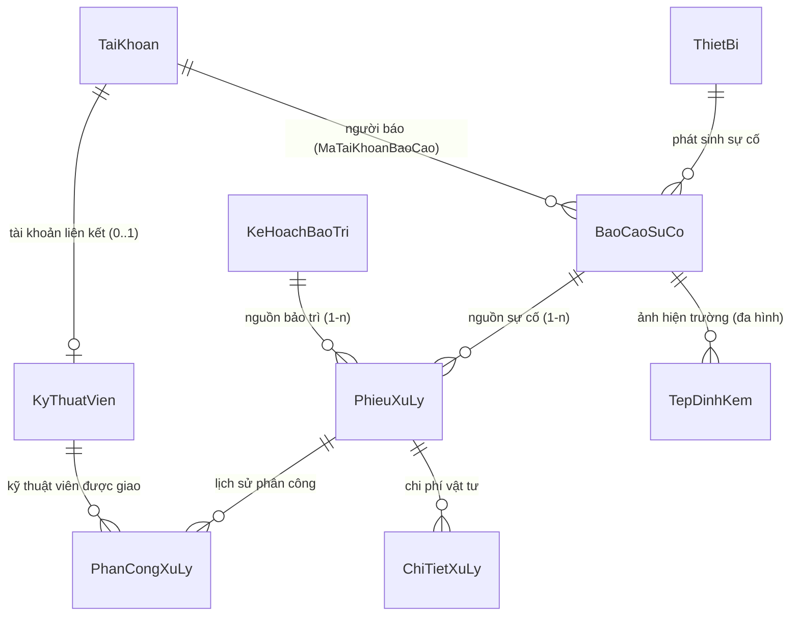

# BÁO CÁO TỰ MÔ TẢ KỸ THUẬT & BỘ CÂU HỎI PHẢN BIỆN BẢO VỆ ĐỒ ÁN
## PHÂN HỆ: MODULE 4 — BÁO CÁO SỰ CỐ, KỸ THUẬT VIÊN, PHIẾU XỬ LÝ & ĐỔI KTV BẢO TOÀN LỊCH SỬ

---

- **Họ và tên sinh viên:** Trịnh Trung Hoàng
- **Mã sinh viên:** 23103100229
- **Lớp:** TI17A4HN
- **Nhóm:** UNETI01
- **Đề tài:** Hệ thống Quản lý Bảo trì Thiết bị và Xử lý Sự cố (MaintainPro)
- **Công nghệ áp dụng:** ASP.NET Core 10 MVC, Entity Framework Core 10, Microsoft SQL Server, C# 13, Bootstrap 5
- **Checklist công việc phụ trách:** STT 07, STT 18, STT 19, STT 35, STT 36, STT 37, STT 38, STT 55

---

## PHẦN I: BÁO CÁO TỰ MÔ TẢ & GIẢI THÍCH KỸ THUẬT

### 1. Tổng quan nghiệp vụ Module 4 đảm nhiệm
Module 4 đóng vai trò là "cầu nối vận hành thực thi" của hệ thống **MaintainPro**, kết nối trực tiếp nhu cầu xử lý hỏng hóc thực tế hoặc nhu cầu bảo dưỡng định kỳ với đội ngũ nhân lực kỹ thuật viên hiện trường. Phân hệ phụ trách các nghiệp vụ cốt lõi sau:

1. **Tiếp nhận & Quản lý Báo cáo sự cố (`BaoCaoSuCo`):**
   - Cho phép người sử dụng trong toàn cơ quan gửi phản ánh sự cố phát sinh tại máy móc, thiết bị mình đang làm việc.
   - Kiểm soát thời gian báo cáo bằng thời gian thực từ máy chủ (Server Timestamp), không cho phép can thiệp thủ công.
   - Phân định rõ quyền riêng tư: người dùng chỉ xem và quản lý các báo cáo do chính mình gửi (`CuaToi`), trong khi ban Quản trị (`Admin`) kiểm soát toàn bộ sự cố toàn cơ quan.
2. **Quản lý Hồ sơ Kỹ thuật viên (`KyThuatVien`):**
   - Quản lý danh sách đội ngũ kỹ thuật viên, trình độ chuyên môn, thông tin liên lạc (số điện thoại, email duy nhất).
   - Liên kết 1-1 (hoặc 1-0..1) với tài khoản đăng nhập hệ thống để cấp quyền truy cập tác nghiệp.
   - Áp dụng nguyên tắc **Xóa an toàn (Safe Delete)**: KTV đã có dữ liệu phân công công việc trong lịch sử không bị xóa vật lý mà chuyển sang trạng thái ngừng hoạt động (`TrangThai = false`).
3. **Quản lý Vòng đời Phiếu xử lý (`PhieuXuLy`):**
   - Phiếu xử lý là chứng từ pháp lý và kỹ thuật ghi nhận việc thực thi bảo dưỡng, sửa chữa, có thể phát sinh từ 2 nguồn: Sự cố đột xuất (`XuLySuCo`) hoặc Kế hoạch bảo trì định kỳ (`BaoTriDinhKy`).
   - Ràng buộc toàn vẹn cơ sở dữ liệu `CK_Phieu_Nguon` đảm bảo đúng một trong hai nguồn được liên kết.
4. **Phân công & Đổi Kỹ thuật viên bảo toàn lịch sử bàn giao (`PhanCongXuLy`):**
   - Mỗi phiếu xử lý tại một thời điểm chỉ có tối đa một kỹ thuật viên phụ trách chính thức (`DangHieuLuc`), được bảo vệ bằng Filtered Unique Index ở tầng CSDL.
   - Khi có thay đổi KTV (ốm đau, bận việc, quá tải, chuyển giao công tác): **Tuyệt đối không sửa đè bản ghi cũ**. Hệ thống kết thúc phân công cũ (lưu ngày kết thúc), tạo bản ghi phân công mới và lưu rõ nguyên nhân bàn giao.
5. **Cơ chế can thiệp an toàn thiết bị:**
   - Khi sự cố ở mức **Cao** hoặc **Khẩn cấp**, hệ thống tự động kích hoạt chuyển trạng thái thiết bị sang **Tạm ngừng do sự cố** (`TamNgungDoSuCo`), cảnh báo ngăn chặn tiếp tục vận hành nguy hiểm.
6. **Đính kèm ảnh hiện trường sự cố (Tính năng nâng cao STT 55):**
   - Hỗ trợ tải lên nhiều hình ảnh chụp hiện trường thực tế, tích hợp xem phóng to qua Modal Lightbox trên cả trang Báo cáo sự cố và trang Chi tiết phiếu xử lý của KTV.

---

### 2. Mô tả kiến trúc 3 lớp (3-Tier Architecture) và luồng dữ liệu

Phân hệ được tổ chức chặt chẽ theo mô hình phân tầng hướng dịch vụ, tuân thủ nguyên tắc **Single Responsibility (SRP)** và **Dependency Inversion (DIP)**:

```
[ Trình duyệt / Razor View (HTML5, Bootstrap 5, AJAX, Lightbox Modal) ]
                                   ↕ (HTTP GET / POST / ViewModels)
[ Lớp Controller: BaoCaoSuCoController, KyThuatVienController, PhieuXuLyController ]
                                   ↕ (ViewModels / DTOs, ServiceResult<T>)
[ Lớp Service: IBaoCaoSuCoService, IKyThuatVienService, IPhieuXuLyService ]
  (Thực thi Business Rules: Timestamp, 2-phase SaveChanges, Check sources, Safe Delete)
                                   ↕ (Entities, IQueryable, AsNoTracking)
[ Lớp Repository: IBaoCaoSuCoRepository, IKyThuatVienRepository, IPhieuXuLyRepository ]
                                   ↕ (LINQ to Entities, Include, Paging)
[ Lớp DbContext / EF Core Change Tracker: AppDbContext ]
                                   ↕ (T-SQL Commands, Foreign Keys, Unique Indexes, Check Constraints)
[ Cơ sở dữ liệu Microsoft SQL Server: MaintainProDb ]
```

- **Lớp Controller:** Tiếp nhận HTTP Request, trích xuất dữ liệu biểu mẫu, xác thực phân quyền qua thuộc tính `[Authorize]`, điều phối gọi Service và trả về View hoặc chuyển hướng kèm thông báo qua TempData. Tuyệt đối không chứa câu lệnh LINQ hay logic nghiệp vụ trực tiếp.
- **Lớp Service:** Trung tâm nghiệp vụ của hệ thống. Kiểm tra tính hợp lệ dữ liệu (số điện thoại, trùng email, trạng thái KTV, trạng thái phiếu, thiết bị), điều phối transaction khi đổi KTV, đồng bộ trạng thái thiết bị, quản lý upload và xóa file ảnh đa hình qua `ITepDinhKemService`. Toàn bộ kết quả được đóng gói trong `ServiceResult` / `ServiceResult<T>`.
- **Lớp Repository:** Đóng gói toàn bộ các truy vấn LINQ to Entities với EF Core, tối ưu hóa tốc độ với `.AsNoTracking()`, triển khai tìm kiếm nhiều tiêu chí, sắp xếp và phân trang `Skip()` / `Take()` ở tầng server.

---

### 3. Thiết kế Cơ sở dữ liệu và quan hệ Entity

Module 4 trực tiếp quản lý và phối hợp 4 bảng nghiệp vụ chính cùng bảng tệp đính kèm đa hình:



#### 3.1. Bảng `BaoCaoSuCo` (Báo cáo sự cố)
- **Khóa chính:** `MaBaoCao` (int, IDENTITY).
- **Khóa ngoại:**
  - `MaThietBi` $\rightarrow$ `ThietBi(MaThietBi)`: Thiết bị phát sinh sự cố (bắt buộc).
  - `MaTaiKhoanBaoCao` $\rightarrow$ `TaiKhoan(MaTaiKhoan)`: Người lập báo cáo (bắt buộc).
- **Các trường thông tin:**
  - `NgayBaoCao`: Ngày giờ phát sinh sự cố, gán cố định bằng `DateTime.Now` phía server.
  - `MoTaSuCo`: Chi tiết hiện tượng hỏng hóc (`nvarchar(500)`).
  - `MucDoSuCo`: Mức độ (`Thap`, `TrungBinh`, `Cao`, `KhanCap`).
  - `TrangThai`: Tiến trình (`MoiBao`, `DangXuLy`, `DaXuLy`, `DaHuy`).
  - `GhiChu`: Thông tin phản hồi / bổ sung (`nvarchar(500)`).

#### 3.2. Bảng `KyThuatVien` (Kỹ thuật viên)
- **Khóa chính:** `MaKyThuatVien` (int, IDENTITY).
- **Khóa ngoại:** `MaTaiKhoan` $\rightarrow$ `TaiKhoan(MaTaiKhoan)` (Nullable, Unique Index có điều kiện `WHERE MaTaiKhoan IS NOT NULL`).
- **Các trường thông tin:**
  - `HoTen`: Họ tên đầy đủ (`nvarchar(100)`).
  - `ChuyenMon`: Chuyên môn kỹ thuật (`nvarchar(150)`).
  - `SoDienThoai`: Định dạng SĐT Việt Nam (`nvarchar(15)`).
  - `Email`: Email liên hệ công việc (`nvarchar(100)`, Unique).
  - `TrangThai`: Trạng thái làm việc (`bit`: `true` = Đang làm việc, `false` = Ngừng hoạt động).

#### 3.3. Bảng `PhieuXuLy` (Phiếu xử lý công việc)
- **Khóa chính:** `MaPhieuXuLy` (int, IDENTITY).
- **Khóa ngoại 2 nguồn:** `MaBaoCao` (Nullable) và `MaKeHoach` (Nullable).
- **Ràng buộc kiểm tra nguồn `CK_Phieu_Nguon` (Fluent API):**
  ```sql
  ([LoaiXuLy] = 'XuLySuCo' AND [MaBaoCao] IS NOT NULL AND [MaKeHoach] IS NULL)
  OR ([LoaiXuLy] = 'BaoTriDinhKy' AND [MaKeHoach] IS NOT NULL AND [MaBaoCao] IS NULL)
  ```
- **Các trường thông tin:**
  - `LoaiXuLy`: Enum (`XuLySuCo`, `BaoTriDinhKy`).
  - `NgayTao`: Thời điểm tạo phiếu (`DateTime.Now`).
  - `NgayBatDau`, `NgayHoanThanh`: Mốc thời gian thực hiện thực tế (Nullable).
  - `TrangThai`: Enum (`ChoPhanCong`, `DaPhanCong`, `DangThucHien`, `HoanThanh`, `DaHuy`).
  - `TongChiPhi`: Thuộc tính động không lưu cột thừa, tính bằng tổng `ThanhTien` từ `ChiTietXuLy`.

#### 3.4. Bảng `PhanCongXuLy` (Phân công và Đổi KTV)
- **Khóa chính:** `MaPhanCong` (int, IDENTITY).
- **Khóa ngoại:** `MaPhieuXuLy` và `MaKyThuatVien`.
- **Các trường thông tin:**
  - `NgayPhanCong`: Thời điểm KTV bắt đầu nhận nhiệm vụ.
  - `NgayKetThucPhanCong`: Thời điểm bàn giao/kết thúc (Nullable, chỉ có giá trị khi đã chuyển giao).
  - `NoiDungPhanCong`: Ghi chú hoặc lý do bàn giao công việc (`nvarchar(500)`).
  - `TrangThai`: Enum (`DangHieuLuc`, `DaKetThuc`).
- **Filtered Unique Index `UX_PhanCong_DangHieuLuc`:**
  ```csharp
  modelBuilder.Entity<PhanCongXuLy>(e =>
  {
      e.HasIndex(x => x.MaPhieuXuLy).IsUnique()
       .HasFilter("[TrangThai] = 'DangHieuLuc'")
       .HasDatabaseName("UX_PhanCong_DangHieuLuc");
  });
  ```
  *Bản chất:* Đảm bảo một phiếu xử lý tại một thời điểm **chỉ có thể tồn tại duy nhất 1 kỹ thuật viên có trạng thái Đang hiệu lực**.

---

### 4. Phân tích chi tiết các chức năng nghiệp vụ trọng tâm

#### 4.1. Nghiệp vụ Báo cáo sự cố (`BaoCaoSuCo`)
- **Server Timestamp:** Trường `NgayBaoCao` được gán trực tiếp bằng `DateTime.Now` trong Service, loại bỏ hoàn toàn khả năng can thiệp thời gian từ phía giao diện client.
- **Trạng thái ban đầu:** Luôn được khởi tạo là `MoiBao`.
- **Kiểm tra thiết bị:** Thiết bị phải tồn tại và chưa ở tình trạng `NgungSuDung`.
- **Phân quyền truy cập:**
  - Hành động `CuaToi`: Sử dụng `User.GetUserId()` để lọc chính xác `MaTaiKhoanBaoCao == userId`, đảm bảo tính riêng tư của từng cán bộ/nhân viên.
  - Hành động `Index`: Yêu cầu quyền `Admin` để theo dõi và điều phối toàn bộ sự cố trong cơ quan.

#### 4.2. Nghiệp vụ Quản lý Kỹ thuật viên & Xóa an toàn (`KyThuatVien`)
- **Validation biểu thức chính quy (Regex):** Kiểm tra định dạng số điện thoại Việt Nam `^(\+84|0)\d{9,10}$`.
- **Chống trùng email:** Kiểm tra `EmailDaTonTaiAsync(email, maKtvExclude)`.
- **Xóa an toàn (Safe Delete):**
  ```csharp
  var coPhanCong = await _repo.DemPhanCongAsync(id, chiDangHieuLuc: false);
  if (coPhanCong > 0)
  {
      return ServiceResult.Fail("Kỹ thuật viên đã từng được phân công công việc, không thể xóa vật lý. Hãy chuyển sang Ngừng hoạt động để bảo lưu lịch sử.");
  }
  ```
  KTV đã có công việc gắn liền với các phiếu xử lý sẽ không bị xóa vật lý (tránh mất vết kiểm toán và vi phạm Foreign Key). Thay vào đó, chuyển `TrangThai = false`.

#### 4.3. Nghiệp vụ Tạo Phiếu xử lý từ 2 nguồn & Ràng buộc `CK_Phieu_Nguon`
- Khi tạo phiếu từ sự cố (`XuLySuCo`): Bắt buộc có `MaBaoCao` hợp lệ, kiểm tra báo cáo chưa bị hủy và chưa có phiếu xử lý nào khác đang hoạt động (`TrangThai != DaHuy`); `MaKeHoach` bắt buộc phải là `null`.
- Khi tạo phiếu từ kế hoạch (`BaoTriDinhKy`): Bắt buộc có `MaKeHoach` hợp lệ, kiểm tra kế hoạch chưa bị hủy/hoàn thành và chưa có phiếu xử lý nào đang hoạt động; `MaBaoCao` bắt buộc phải là `null`.
- CSDL áp dụng Check Constraint `CK_Phieu_Nguon` như một tầng phòng thủ dữ liệu độc lập, ngăn chặn hoàn toàn việc dữ liệu sai lệch nếu có truy vấn trực tiếp từ ngoài tầng ứng dụng.

#### 4.4. Nghiệp vụ Phân công xử lý (`PhanCongXuLy`)
- Phiếu xử lý phải ở trạng thái cho phép phân công (không ở trạng thái `HoanThanh` hoặc `DaHuy`).
- Kỹ thuật viên được chọn phải có trạng thái hoạt động (`TrangThai == true`). Hệ thống kiểm tra hai tầng:
  1. Tại Service: Kiểm tra `ktv.TrangThai`.
  2. Tại DbContext (`ValidateAssignmentsAsync`): Chặn đứng việc SaveChanges nếu gán KTV đã ngừng hoạt động.
- Khi phân công thành công, trạng thái phiếu xử lý tự động chuyển từ `ChoPhanCong` $\rightarrow$ `DaPhanCong`.

#### 4.5. Cơ chế Đổi Kỹ thuật viên bảo toàn lịch sử bàn giao (STT 37) & Kỹ thuật giải phóng Filtered Unique Index
- **Bài toán đặt ra:** Một phiếu đang do KTV A phụ trách. Do phát sinh lý do đột xuất, quản trị viên cần chuyển giao phiếu cho KTV B. Hệ thống phải lưu lại thông tin KTV A đã từng tham gia, thời điểm kết thúc, lý do bàn giao và thời điểm KTV B tiếp quản.
- **Thách thức kỹ thuật:** Cơ sở dữ liệu có Filtered Unique Index `UX_PhanCong_DangHieuLuc` trên cột `MaPhieuXuLy` với điều kiện `[TrangThai] = 'DangHieuLuc'`. Nếu thực hiện cập nhật phân công cũ và chèn phân công mới trong cùng một thao tác `SaveChanges` mà EF Core sắp xếp thứ tự INSERT trước UPDATE, SQL Server sẽ ném lỗi vi phạm Unique Constraint:
  $$\text{Violation of UNIQUE KEY constraint 'UX\_PhanCong\_DangHieuLuc'}$$
- **Giải pháp xử lý tối ưu (2-Phase SaveChanges):**
  ```csharp
  // Bước 1: Tìm phân công đang hiệu lực hiện tại
  var phanCongCu = await _phieuRepo.LayPhanCongHienTaiAsync(model.MaPhieuXuLy);
  if (phanCongCu != null)
  {
      if (phanCongCu.MaKyThuatVien == model.MaKyThuatVienMoi.Value)
          return ServiceResult.Fail("Kỹ thuật viên này hiện đang phụ trách phiếu rồi, không cần đổi.");

      // Cập nhật trạng thái phân công cũ thành DaKetThuc và lưu mốc thời gian kết thúc
      phanCongCu.TrangThai = TrangThaiPhanCongEnum.DaKetThuc;
      phanCongCu.NgayKetThucPhanCong = DateTime.Now;

      // BẮT BUỘC gọi SaveChangesAsync() để giải phóng Filtered Unique Index ở CSDL trước
      await _context.SaveChangesAsync();
  }

  // Bước 2: Tạo bản ghi phân công mới cho KTV mới với trạng thái DangHieuLuc
  var phanCongMoi = new PhanCongXuLy
  {
      MaPhieuXuLy = model.MaPhieuXuLy,
      MaKyThuatVien = model.MaKyThuatVienMoi.Value,
      NgayPhanCong = DateTime.Now,
      TrangThai = TrangThaiPhanCongEnum.DangHieuLuc,
      NoiDungPhanCong = $"[Đổi KTV] {model.LyDoDoi.Trim()}"
  };

  await _phieuRepo.ThemPhanCongAsync(phanCongMoi);
  await _phieuRepo.SaveChangesAsync();
  ```
  Nhờ quy trình 2 bước trên, chỉ số Unique Index được giải phóng trước khi bản ghi mới được ghi nhận, đảm bảo toàn vẹn dữ liệu 100% mà không bị lỗi xung đột chỉ mục.

#### 4.6. Tự động chuyển trạng thái Thiết bị sang "Tạm ngừng do sự cố"
- Khi người dùng gửi báo cáo sự cố mức độ **Cao** hoặc **Khẩn cấp**, hoặc Admin tích chọn "Tạm ngưng thiết bị" khi lập phiếu:
  ```csharp
  bool laSuCoNghiemTrong = bc.MucDoSuCo == MucDoSuCoEnum.Cao || bc.MucDoSuCo == MucDoSuCoEnum.KhanCap;
  if (model.TamNgungThietBi || laSuCoNghiemTrong)
  {
      if (bc.ThietBi != null && bc.ThietBi.TinhTrang == TinhTrangThietBiEnum.DangHoatDong)
      {
          bc.ThietBi.TinhTrang = TinhTrangThietBiEnum.TamNgungDoSuCo;
      }
  }
  ```
- Cơ chế này bảo vệ hệ thống vận hành thực tế: máy hỏng nặng lập tức bị tạm ngừng, tránh việc công nhân khác vô tình mở máy gây tai nạn lao động hoặc hỏng hóc nặng thêm.

#### 4.7. Đính kèm ảnh hiện trường sự cố (Tệp đính kèm đa hình - STT 55)
- **Kiến trúc Đa hình (Polymorphic Attachment):** Sử dụng bảng `TepDinhKem` dùng chung toàn dự án với cặp khóa định danh `(LoaiDoiTuong = LoaiDoiTuongDinhKemEnum.BaoCaoSuCo, MaDoiTuong = MaBaoCao)`.
- **Upload an toàn:**
  - Kiểm tra định dạng tệp: chỉ chấp nhận file ảnh an toàn (`.jpg`, `.jpeg`, `.png`, `.gif`, `.webp`), dung lượng $\le 10\text{MB}$.
  - Sinh tên file lưu trên ổ cứng bằng `Guid.NewGuid().ToString() + extension`, ngăn chặn hoàn toàn nguy cơ tấn công Path Traversal hoặc ghi đè file.
  - Lưu trữ tại thư mục `wwwroot/uploads/baocaosuco/`.
- **Tích hợp hiển thị & Xóa an toàn:**
  - Hiển thị Gallery ảnh trực quan kèm modal phóng to Lightbox trên trang `BaoCaoSuCo/Details` và `PhieuXuLy/Details`.
  - Khi xóa báo cáo sự cố, hệ thống thực hiện dọn dẹp triệt để: gọi `XoaToanBoTheoDoiTuongAsync` xóa toàn bộ bản ghi CSDL và xóa các file vật lý khỏi ổ cứng máy chủ, ngăn chặn rác tệp mồ côi (orphan files).

---

### 5. Các câu truy vấn LINQ trọng tâm

#### 5.1. LINQ lấy Kỹ thuật viên phụ trách hiện tại của một phiếu (STT 36)
```csharp
public Task<KyThuatVien?> LayKtvHienTaiAsync(int maPhieuXuLy) =>
    _context.PhanCongXuLys
        .AsNoTracking()
        .Where(pc => pc.MaPhieuXuLy == maPhieuXuLy && pc.TrangThai == TrangThaiPhanCongEnum.DangHieuLuc)
        .Select(pc => pc.KyThuatVien)
        .FirstOrDefaultAsync();
```
*Tối ưu hóa:* Câu lệnh kết hợp `.AsNoTracking()`, `Where` với trạng thái `DangHieuLuc`, và phép chiếu `.Select(pc => pc.KyThuatVien)`. EF Core biên dịch trực tiếp sang câu lệnh T-SQL với `SELECT TOP(1) ... FROM PhanCongXuLy INNER JOIN KyThuatVien` chỉ nạp các cột của bảng KTV, không tải dư thừa dữ liệu.

#### 5.2. LINQ lấy Lịch sử phân công công việc (STT 37)
```csharp
public async Task<List<PhanCongXuLyLichSuRow>> LayLichSuPhanCongAsync(int maPhieuXuLy) =>
    await _context.PhanCongXuLys
        .AsNoTracking()
        .Where(pc => pc.MaPhieuXuLy == maPhieuXuLy)
        .OrderByDescending(pc => pc.NgayPhanCong)
        .ThenByDescending(pc => pc.MaPhanCong)
        .Select(pc => new PhanCongXuLyLichSuRow(
            pc.MaPhanCong,
            pc.MaKyThuatVien,
            pc.KyThuatVien!.HoTen,
            pc.KyThuatVien.ChuyenMon,
            pc.KyThuatVien.SoDienThoai,
            pc.KyThuatVien.Email,
            pc.NgayPhanCong,
            pc.NgayKetThucPhanCong,
            pc.NoiDungPhanCong,
            pc.TrangThai
        ))
        .ToListAsync();
```
*Tối ưu hóa:* Sử dụng Projection trực tiếp sang Record DTO `PhanCongXuLyLichSuRow`, giúp dữ liệu trả về nhẹ và an toàn để hiển thị trên bảng lịch sử bàn giao.

#### 5.3. LINQ Tìm kiếm, Lọc nhiều tiêu chí, Tính tổng chi phí và Phân trang (STT 35)
```csharp
var query = _context.PhieuXuLys.AsNoTracking();

// 1. Where: Lọc theo Loại xử lý, Trạng thái, Khoảng thời gian, KTV phụ trách
if (boLoc.LoaiXuLy.HasValue)
    query = query.Where(p => p.LoaiXuLy == boLoc.LoaiXuLy.Value);

if (boLoc.TrangThai.HasValue)
    query = query.Where(p => p.TrangThai == boLoc.TrangThai.Value);

if (boLoc.MaKyThuatVien.HasValue)
    query = query.Where(p => p.PhanCongXuLys.Any(pc =>
        pc.MaKyThuatVien == boLoc.MaKyThuatVien.Value && pc.TrangThai == TrangThaiPhanCongEnum.DangHieuLuc));

// 2. Phân trang và chiếu dữ liệu kèm tổng chi phí
var items = await query
    .OrderByDescending(p => p.NgayTao)
    .Skip((page - 1) * pageSize)
    .Take(pageSize)
    .Select(p => new PhieuXuLyListItemDto {
        MaPhieuXuLy = p.MaPhieuXuLy,
        LoaiXuLy = p.LoaiXuLy,
        TrangThai = p.TrangThai,
        TenThietBi = p.LoaiXuLy == LoaiXuLyEnum.XuLySuCo 
            ? p.BaoCaoSuCo!.ThietBi!.TenThietBi 
            : p.KeHoachBaoTri!.ThietBi!.TenThietBi,
        PhanCongHienTai = p.PhanCongXuLys
            .Where(pc => pc.TrangThai == TrangThaiPhanCongEnum.DangHieuLuc)
            .Select(pc => pc.KyThuatVien!.HoTen)
            .FirstOrDefault(),
        TongChiPhi = p.ChiTietXuLys.Sum(c => c.ThanhTien ?? 0m)
    })
    .ToListAsync();
```
*Tối ưu hóa:* `TongChiPhi` được tính động ngay trong truy vấn SQL Server bằng hàm tổng hợp `SUM`, không cần truy vấn riêng lẻ hay lưu cột dư thừa trong CSDL.

---

### 6. Thiết kế Giao diện & Ma trận phân quyền truy cập

#### 6.1. Ma trận phân quyền tại Controller (`[Authorize]`)

| Controller / Action | Admin | Kỹ thuật viên | Người sử dụng | Mục đích nghiệp vụ |
| :--- | :---: | :---: | :---: | :--- |
| `BaoCaoSuCo/Create` | ✔️ | ✔️ | ✔️ | Báo cáo sự cố khi phát hiện hỏng hóc |
| `BaoCaoSuCo/CuaToi` | ✔️ | ✔️ | ✔️ | Xem danh sách sự cố do chính mình báo |
| `BaoCaoSuCo/Index` (Toàn bộ) | ✔️ | ❌ | ❌ | Giám sát, quản lý toàn bộ sự cố trong hệ thống |
| `KyThuatVien/*` (Toàn bộ) | ✔️ | ❌ | ❌ | Quản trị hồ sơ và chuyên môn KTV |
| `PhieuXuLy/Index` | ✔️ | ✔️ | ❌ | Xem danh sách phiếu theo phân quyền |
| `PhieuXuLy/ViecCuaToi` | ❌ | ✔️ | ❌ | Màn hình tác nghiệp riêng cho từng KTV |
| `PhieuXuLy/Create, PhanCong, DoiKtv, Huy` | ✔️ | ❌ | ❌ | Chỉ Admin được quyền phân công và điều phối nhân sự |

#### 6.2. Các màn hình giao diện đã hoàn thiện
1. **`BaoCaoSuCo/Index.cshtml` & `CuaToi.cshtml`:** Bảng sự cố có phân trang, badge mức độ ưu tiên/trạng thái, hiển thị số ảnh đính kèm.
2. **`BaoCaoSuCo/Details.cshtml`:** Thông tin chi tiết sự cố, thông tin người báo, thư viện ảnh hiện trường trực quan (Gallery Grid) kèm Lightbox xem phóng to ảnh và nút upload ảnh bổ sung.
3. **`KyThuatVien/Index.cshtml`:** Danh mục kỹ thuật viên kèm chuyên môn, số điện thoại, trạng thái hoạt động (bật/tắt) và kiểm soát xóa an toàn.
4. **`PhieuXuLy/Index.cshtml`:** Màn hình trung tâm quản lý phiếu xử lý, tích hợp bộ lọc đa năng (Loại xử lý, Trạng thái, KTV, Thời gian), hiển thị KTV phụ trách và chi phí vật tư.
5. **`PhieuXuLy/Details.cshtml`:** Hồ sơ chi tiết phiếu xử lý: thông tin nguồn công việc (kèm ảnh hiện trường nếu từ sự cố), thẻ KTV phụ trách hiện tại, **bảng lịch sử bàn giao công việc qua các đời KTV**, modal phân công KTV và **modal Đổi KTV kèm lý do bàn giao**.
6. **`PhieuXuLy/ViecCuaToi.cshtml`:** Không gian làm việc cá nhân của KTV, chỉ hiển thị các phiếu mình đang được giao xử lý.

---

## PHẦN II: BỘ CÂU HỎI PHẢN BIỆN & KỊCH BẢN BẢO VỆ ĐỒ ÁN (SV4)

Dưới đây là các câu hỏi trọng tâm thường được hội đồng chấm đồ án đặt ra cho sinh viên phụ trách Module 4 cùng câu trả lời kỹ thuật chi tiết:

---

### Câu hỏi 1: Tại sao trong bảng `PhieuXuLy` cả hai khóa ngoại `MaBaoCao` và `MaKeHoach` đều là Nullable? Làm cách nào em bảo đảm không xảy ra lỗi cả 2 cùng có dữ liệu hoặc cả 2 cùng NULL?
* **Trả lời:**
  - **Lý do thiết kế:** Phiếu xử lý là nơi triển khai công việc bảo trì, sửa chữa trong thực tế. Công việc này có thể xuất phát từ hai nguồn nghiệp vụ hoàn toàn khác nhau:
    1. Xử lý sự cố đột xuất do người dùng báo cáo (`XuLySuCo`).
    2. Thực hiện bảo trì định kỳ theo kế hoạch định sẵn (`BaoTriDinhKy`).
    Do mỗi phiếu chỉ bắt nguồn từ duy nhất một nguồn, nên một trong hai khóa ngoại bắt buộc phải là `NULL`. Vì vậy, cả hai cột bắt buộc phải được khai báo là `Nullable` trong Entity Framework Core.
  - **Cơ chế đảm bảo toàn vẹn dữ liệu (Phòng thủ 2 lớp):**
    1. *Tầng Cơ sở dữ liệu (Database level):* Em cấu hình Check Constraint `CK_Phieu_Nguon` thông qua Fluent API trong `AppDbContext`:
       ```sql
       ([LoaiXuLy] = 'XuLySuCo' AND [MaBaoCao] IS NOT NULL AND [MaKeHoach] IS NULL)
       OR ([LoaiXuLy] = 'BaoTriDinhKy' AND [MaKeHoach] IS NOT NULL AND [MaBaoCao] IS NULL)
       ```
       Ràng buộc này được thực thi ở mức nhân SQL Server, bảo đảm dữ liệu luôn đúng dù được chèn từ ứng dụng, trigger, hay qua các công cụ quản trị CSDL ngoài.
    2. *Tầng Ứng dụng (Application Service level):* Trong phương thức `TaoPhieuXuLyAsync` của `PhieuXuLyService`, em kiểm tra logic tương ứng với từng loại xử lý trước khi lưu vào DbContext để hiển thị thông báo lỗi tường minh, thân thiện cho người dùng.

---

### Câu hỏi 2: Trình bày cơ chế Đổi Kỹ thuật viên mà không làm mất lịch sử phân công công việc? Tại sao em phải gọi `SaveChangesAsync()` 2 lần trong phương thức `DoiKyThuatVienAsync`?
* **Trả lời:**
  - **Cơ chế bảo toàn lịch sử:**
    - Thay vì dùng lệnh `UPDATE` sửa đè `MaKyThuatVien` trên bản ghi cũ, em quản lý lịch sử thông qua bảng trung gian `PhanCongXuLy`.
    - Khi có yêu cầu đổi KTV: Em tìm bản ghi phân công cũ đang có hiệu lực (`TrangThai = DangHieuLuc`), cập nhật trạng thái của nó thành `DaKetThuc` và lưu `NgayKetThucPhanCong = DateTime.Now`.
    - Sau đó, em chèn một bản ghi `PhanCongXuLy` hoàn toàn mới cho KTV mới với trạng thái `DangHieuLuc`, ghi rõ `NgayPhanCong` và lý do đổi vào cột `NoiDungPhanCong`. Toàn bộ quá trình này giúp bảng `PhanCongXuLy` lưu giữ trọn vẹn toàn bộ các đời KTV từng phụ trách phiếu.
  - **Lý do gọi `SaveChangesAsync()` 2 lần:**
    - Trong CSDL, em đã tạo một **Filtered Unique Index** có tên `UX_PhanCong_DangHieuLuc` trên cột `MaPhieuXuLy` với điều kiện `WHERE [TrangThai] = 'DangHieuLuc'`. Index này đảm bảo một phiếu chỉ có duy nhất 1 bản ghi `DangHieuLuc` tại một thời điểm.
    - Nếu em thực hiện sửa bản ghi cũ và thêm bản ghi mới rồi chỉ gọi `SaveChangesAsync()` một lần ở cuối, Entity Framework Core có thể sinh câu lệnh `INSERT` bản ghi mới trước câu lệnh `UPDATE` bản ghi cũ. Lúc này, trên CSDL sẽ xuất hiện đồng thời 2 bản ghi `DangHieuLuc` cho cùng 1 phiếu, vi phạm chỉ mục duy nhất và khiến SQL Server ném ngoại lệ `DbUpdateException`.
    - Việc gọi `await _context.SaveChangesAsync()` ngay sau khi đổi trạng thái bản ghi cũ thành `DaKetThuc` sẽ gửi lệnh `UPDATE` xuống SQL Server ngay lập tức, giải phóng chỉ mục duy nhất trước khi bản ghi mới được `INSERT` ở lần `SaveChangesAsync()` thứ hai.

---

### Câu hỏi 3: Làm thế nào để lấy ra Kỹ thuật viên đang phụ trách hiện tại của một Phiếu xử lý bằng LINQ? Truy vấn này được tối ưu hóa như thế nào?
* **Trả lời:**
  - Em sử dụng câu truy vấn LINQ:
    ```csharp
    public Task<KyThuatVien?> LayKtvHienTaiAsync(int maPhieuXuLy) =>
        _context.PhanCongXuLys
            .AsNoTracking()
            .Where(pc => pc.MaPhieuXuLy == maPhieuXuLy && pc.TrangThai == TrangThaiPhanCongEnum.DangHieuLuc)
            .Select(pc => pc.KyThuatVien)
            .FirstOrDefaultAsync();
    ```
  - **Tối ưu hóa kỹ thuật:**
    1. Dùng `.AsNoTracking()` để ngắt bộ nhớ theo dõi đối tượng (Change Tracker) của EF Core, giúp giảm tiêu hao bộ nhớ RAM và tăng tốc độ đọc dữ liệu.
    2. Dùng toán tử chiếu `.Select(pc => pc.KyThuatVien)` kết hợp Navigation Property. EF Core sẽ tự động biên dịch sang câu lệnh SQL chứa `SELECT TOP(1) ... FROM PhanCongXuLy INNER JOIN KyThuatVien` và chỉ nạp các cột của bảng `KyThuatVien`, không tải dư thừa các cột của bảng trung gian `PhanCongXuLy`.

---

### Câu hỏi 4: Khi nào thiết bị được tự động chuyển sang trạng thái "Tạm ngừng do sự cố"? Nghiệp vụ này có ý nghĩa gì?
* **Trả lời:**
  - **Thời điểm kích hoạt:** Khi người dùng gửi báo cáo sự cố có mức độ nghiêm trọng là **Cao (`Cao`)** hoặc **Khẩn cấp (`KhanCap`)**, hệ thống trong phương thức tạo báo cáo hoặc lập phiếu xử lý sẽ tự động kiểm tra tình trạng hiện tại của thiết bị. Nếu thiết bị đang ở trạng thái `DangHoatDong`, hệ thống sẽ cập nhật trạng thái của thiết bị sang `TamNgungDoSuCo`.
  - **Ý nghĩa thực tế:**
    - Trong môi trường sản xuất hoặc vận hành cơ quan/nhà máy, khi thiết bị gặp sự cố nghiêm trọng (ví dụ: rò rỉ điện, cháy nổ, kẹt động cơ), việc tiếp tục vận hành có thể gây tai nạn lao động nghiêm trọng hoặc làm hỏng hoàn toàn thiết bị.
    - Việc tự động chuyển sang `TamNgungDoSuCo` giúp khóa ngay quyền lập lịch hoặc phân công sử dụng thiết bị ở Module 2 & 3, đồng thời hiển thị cảnh báo đỏ trên toàn hệ thống cho đến khi KTV hoàn thành sửa chữa và nghiệm thu xong.

---

### Câu hỏi 5: Tại sao trong bảng `KyThuatVien` có trường `TrangThai` kiểu `bool` mà không xóa hẳn (Hard Delete) khi kỹ thuật viên nghỉ việc?
* **Trả lời:**
  - **Nguyên tắc Xóa an toàn (Soft Delete):** Trong hệ thống quản lý bảo trì, dữ liệu lịch sử sửa chữa thiết bị là hồ sơ tài sản quan trọng phục vụ công tác kiểm toán, đánh giá khấu hao và đối soát kỹ thuật.
  - Nếu áp dụng xóa cứng (`DELETE FROM KyThuatVien WHERE MaKyThuatVien = @id`):
    - Nếu KTV đã từng phụ trách phiếu xử lý, câu lệnh SQL sẽ bị lỗi vi phạm ràng buộc khóa ngoại (Foreign Key Constraint Violation) với bảng `PhanCongXuLy`.
    - Nếu xóa dây chuyền (Cascade Delete), toàn bộ lịch sử phân công và dữ liệu sửa chữa trong quá khứ liên quan đến KTV đó sẽ bị xóa sạch, làm mất vết dữ liệu.
  - Vì vậy, em áp dụng cơ chế:
    1. Kiểm tra nếu KTV chưa từng có phân công nào thì mới cho phép xóa vật lý.
    2. Nếu đã từng có phân công, hệ thống chặn xóa và hướng dẫn người quản trị chuyển `TrangThai = false` (Ngừng hoạt động). Khi ngừng hoạt động, KTV sẽ bị loại khỏi danh sách phân công mới nhưng toàn bộ dữ liệu lịch sử các lần sửa chữa trước đây vẫn được bảo lưu vẹn toàn.

---

### Câu hỏi 6: Tính năng Đính kèm ảnh hiện trường sự cố (STT 55) được em thiết kế kiến trúc và đảm bảo bảo mật ra sao?
* **Trả lời:**
  - **Về mô hình dữ liệu đa hình (Polymorphic Pattern):** Em sử dụng bảng `TepDinhKem` dùng chung cho toàn bộ hệ thống với cặp trường `LoaiDoiTuong = 'BaoCaoSuCo'` và `MaDoiTuong = MaBaoCao`. Cách làm này giúp bảng `BaoCaoSuCo` giữ được cấu trúc gọn gàng, đồng thời cho phép một sự cố có thể đính kèm nhiều ảnh tùy ý (1-n) mà không cần tạo thêm các cột ảnh tĩnh (`HinhAnh1`, `HinhAnh2`...).
  - **Về an toàn bảo mật khi upload:**
    1. *Kiểm duyệt định dạng:* Sử dụng cấu hình `chiChapNhanAnh: true`, chỉ cho phép các phần mở rộng ảnh an toàn (`.jpg`, `.jpeg`, `.png`, `.webp`, `.gif`), chặn hoàn toàn các tệp mã nguồn hoặc file thực thi nguy hiểm (`.exe`, `.dll`, `.aspx`, `.php`).
    2. *Đổi tên tệp bằng GUID:* Không sử dụng tên file gốc do người dùng tải lên mà đổi thành chuỗi GUID ngẫu nhiên kết hợp với phần mở rộng (`Guid.NewGuid().ToString() + ext`). Điều này ngăn chặn triệt để lỗ hổng tấn công ghi đè file và tấn công vượt đường dẫn (Path Traversal).
    3. *Giới hạn dung lượng:* Kiểm tra kích thước tối đa 10MB cho mỗi tệp.
  - **Về tính toàn vẹn khi dọn dẹp dữ liệu:** Khi một báo cáo sự cố bị xóa (`XoaAsync`), Service gọi `ITepDinhKemService.XoaToanBoTheoDoiTuongAsync` để xóa toàn bộ bản ghi trong CSDL và xóa các file vật lý tương ứng trong thư mục `wwwroot/uploads/baocaosuco/`, đảm bảo không để lại tệp rác mồ côi trên máy chủ.
  - **Về hiển thị:** Tích hợp Gallery ảnh kèm modal phóng to Lightbox trên cả trang `BaoCaoSuCo/Details` và `PhieuXuLy/Details`, giúp kỹ thuật viên có thể xem cận cảnh vết nứt, cháy hỏng trước khi đến hiện trường.

---

### Câu hỏi 7: Khi một Phiếu xử lý được chuyển sang trạng thái "Hoàn thành" hoặc "Đã hủy", trạng thái của Báo cáo sự cố và Thiết bị được cập nhật như thế nào?
* **Trả lời:**
  - **Khi Phiếu xử lý "Hoàn thành" (`HoanThanh`):**
    - Nếu phiếu bắt nguồn từ Báo cáo sự cố (`XuLySuCo`): Báo cáo sự cố tương ứng sẽ được tự động chuyển trạng thái từ `DangXuLy` sang `DaXuLy`.
    - Thiết bị liên quan: Nếu trước đó đang ở trạng thái `TamNgungDoSuCo`, hệ thống sẽ phục hồi trạng thái của thiết bị trở lại `DangHoatDong`, cho phép đưa vào khai thác sử dụng bình thường.
    - Cập nhật thời điểm `NgayHoanThanh = DateTime.Now` trên phiếu xử lý.
  - **Khi Phiếu xử lý bị "Đã hủy" (`DaHuy`):**
    - Phân công đang hiệu lực của KTV sẽ được kết thúc.
    - Báo cáo sự cố liên kết được trả về trạng thái ban đầu (`MoiBao`) hoặc đánh dấu hủy tùy theo nguyên nhân hủy phiếu, cho phép người quản trị có thể xem xét lập phiếu xử lý khác thay thế.
    - Toàn bộ các thao tác chuyển đổi trạng thái này đều được kiểm soát trong Service layer nhằm đảm bảo tính nhất quán dữ liệu trên toàn bộ các phân hệ của MaintainPro.

---

*Hà Nội, Ngày 09 tháng 11 năm 2026*  
**Sinh viên thực hiện & Báo cáo viên:**  
**Trịnh Trung Hoàng**  
*(Mã sinh viên: 23103100229 — Lớp: TI17A4HN)*
