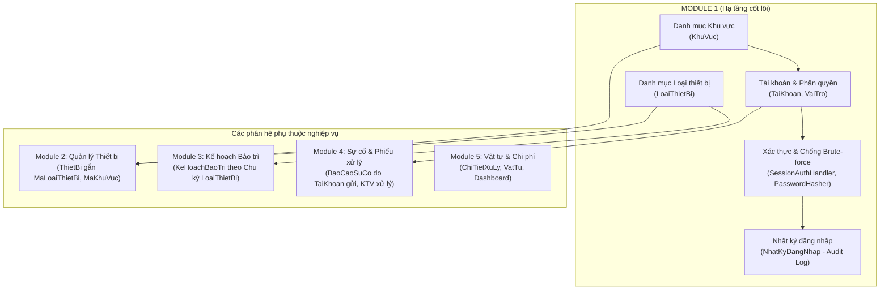
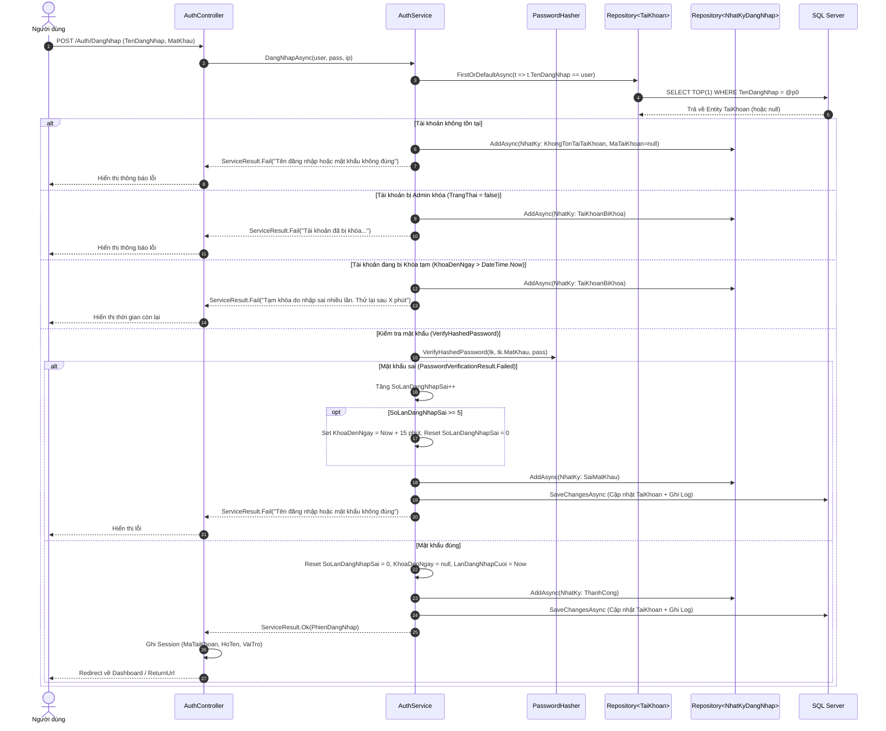

# BÁO CÁO TỰ MÔ TẢ KỸ THUẬT & BỘ CÂU HỎI PHẢN BIỆN BẢO VỆ ĐỒ ÁN
## PHÂN HỆ: MODULE 1 — QUẢN TRỊ HỆ THỐNG, TÀI KHOẢN, DANH MỤC & XÁC THỰC BẢO MẬT

---

- **Họ và tên sinh viên:** Nguyễn Văn Hoàng
- **Mã sinh viên:** 23103100303
- **Lớp:** TI17A4HN
- **Nhóm:** UNETI01
- **Đề tài:** Hệ thống Quản lý và Bảo trì Thiết bị (MaintainPro)
- **Công nghệ áp dụng:** ASP.NET Core 10 MVC, Entity Framework Core 10, Microsoft SQL Server, C# 13, Bootstrap 5, ClosedXML
- **Phân hệ đảm nhiệm:** Module 1 — Quản lý Tài khoản, Loại thiết bị, Khu vực, Cơ chế Xác thực Session, Khóa tạm chống Brute-force & Nhật ký đăng nhập (Audit Log)

---

## MỤC I: BÁO CÁO TỰ MÔ TẢ & GIẢI THÍCH KỸ THUẬT

### 1. Tổng quan nghiệp vụ Module 1 trong toàn bộ dự án

Module 1 đóng vai trò là **"Hạ tầng nền móng" (Foundational Infrastructure)** cho toàn bộ hệ thống **MaintainPro**. Mọi thực thể nghiệp vụ ở các module sau (Thiết bị ở Module 2, Kế hoạch bảo trì ở Module 3, Báo cáo sự cố & Phiếu xử lý ở Module 4, Chi tiết vật tư ở Module 5) đều phụ thuộc trực tiếp vào dữ liệu nguồn và cơ chế định danh phân quyền do Module 1 cung cấp:



Phân hệ phụ trách các nghiệp vụ cốt lõi sau:
1. **Quản lý danh mục cơ sở (Master Data Management):**
   - **Khu vực (`KhuVuc`):** Quản lý tòa nhà, phân xưởng, phòng ban, người phụ trách và vị trí lắp đặt máy móc. Khu vực đóng vai trò thiết lập phạm vi vận hành cho thiết bị và nhân viên.
   - **Loại thiết bị (`LoaiThietBi`):** Chuẩn hóa nhóm phân loại tài sản kỹ thuật, quy định chỉ số **Chu kỳ bảo trì mặc định (tháng)** để tự động áp dụng khi thêm mới thiết bị vào nhà xưởng.
2. **Quản lý Danh tính & Phân quyền người dùng (Identity & Access Management - IAM):**
   - Quản trị hồ sơ tài khoản toàn cơ quan (`TaiKhoan`), phân chia 3 cấp bậc vai trò độc lập (`Admin`, `KyThuatVien`, `NguoiSuDung`).
   - Ràng buộc phân quyền dữ liệu theo phạm vi: Người sử dụng (`NguoiSuDung`) bắt buộc liên kết với một `KhuVuc` cụ thể để chỉ được giám sát và báo cáo sự cố tại đơn vị mình.
3. **Kiến trúc Xác thực tùy biến bảo mật cao (Custom Session-based Authentication):**
   - Triển khai xác thực qua `SessionAuthenticationHandler` kết hợp Session Middleware và `ClaimsPrincipal`, độc lập hoàn toàn với framework ASP.NET Core Identity cồng kềnh, tránh phát sinh bảng dư thừa.
   - Băm mật khẩu một chiều bằng thuật toán `PasswordHasher<TaiKhoan>` tiêu chuẩn mã hóa PBKDF2 with HMAC-SHA256 kết hợp Salt ngẫu nhiên.
4. **Cơ chế Khóa tạm chống tấn công dò quét mật khẩu (Brute-force Attack Mitigation):**
   - Tự động theo dõi số lần đăng nhập sai liên tiếp (`SoLanDangNhapSai`).
   - Tự động khóa tạm tài khoản trong vòng 15 phút (`KhoaDenNgay = Now + 15 phút`) khi sai vượt ngưỡng 5 lần. Tự động phục hồi khi hết hạn hoặc khi đăng nhập thành công.
5. **Nhật ký kiểm toán truy cập vĩnh viễn (Audit Log - `NhatKyDangNhap`):**
   - Ghi nhận 100% lịch sử nỗ lực đăng nhập (thành công, sai mật khẩu, tài khoản bị khóa, hoặc cố tình dò username không tồn tại).
   - Áp dụng nguyên tắc **Bất biến (Immutable Log)**: Không cung cấp chức năng sửa hay xóa vật lý bất kỳ dòng nhật ký nào.
   - Trang tra cứu phân trang server-side, bộ lọc nâng cao và hỗ trợ trích xuất báo cáo Excel định dạng chuẩn.

---

### 2. Mô tả kiến trúc 3 lớp (3-Tier Architecture) và luồng dữ liệu

Module được thiết kế tuân thủ nghiêm ngặt mô hình tách tầng trách nhiệm (**Separation of Concerns - SoC**), chuẩn hóa nguyên lý **Single Responsibility Principle (SRP)** và **Dependency Inversion Principle (DIP)**:

```
[ Trình duyệt / Client (Razor Views, Bootstrap 5, AJAX, Form Validation) ]
                                    ↕ (HTTP GET / POST / ViewModels)
[ Tầng Controller: AuthController, TaiKhoanController, KhuVucController, LoaiThietBiController, NhatKyDangNhapController ]
  - Tiếp nhận Request, xác thực ModelState, Anti-Forgery Token, đọc ClaimsPrincipal
  - Điều hướng View, gán TempData thông báo, trả về File Download (Excel)
                                    ↕ (ViewModels, ServiceResult<T>)
[ Tầng Service: IAuthService, ITaiKhoanService, IKhuVucService, ILoaiThietBiService, INhatKyDangNhapService ]
  - Xử lý Business Logic, kiểm tra toàn vẹn nghiệp vụ, băm mật khẩu
  - Đếm số lần đăng nhập sai, tính thời gian khóa tạm, ngăn tự khóa Admin cuối cùng
                                    ↕ (Entities, DTOs, IQueryable)
[ Tầng Repository: ITaiKhoanRepository, IKhuVucRepository, ILoaiThietBiRepository, INhatKyDangNhapRepository ]
  - Trừu tượng hóa truy vấn EF Core, tối ưu AsNoTracking(), Skip/Take phân trang
  - Kiểm tra tồn tại duy nhất (Unique check), đếm bản ghi liên quan (FK Cascade check)
                                    ↕ (LINQ to Entities, SQL Queries)
[ Tầng ORM & Cơ sở dữ liệu: AppDbContext -> Microsoft SQL Server (MaintainProDb) ]
```

#### Sơ đồ tuần tự: Luồng xử lý Đăng nhập & Chống Brute-force



---

### 3. Chi tiết thiết kế Cơ sở dữ liệu và các Entity

Mô hình dữ liệu của Module 1 được thiết kế đạt **Chuẩn hóa bậc 3 (3NF)**, triệt tiêu hoàn toàn dư thừa dữ liệu và bảo đảm tính toàn vẹn tham chiếu thông qua các khóa ngoại, chỉ mục duy nhất và ràng buộc CHECK:

#### A. Thực thể `TaiKhoan`
- **Khóa chính (`MaTaiKhoan`):** Kiểu `int`, tự động tăng (`IDENTITY`).
- **Thông tin nhận diện:**
  - `TenDangNhap`: `nvarchar(50)`, `[Required]`, Unique Index ngăn trùng lặp tài khoản trên toàn hệ thống.
  - `MatKhau`: `nvarchar(255)`, lưu chuỗi mật khẩu đã được băm PBKDF2 with HMAC-SHA256. Tuyệt đối không lưu bản rõ (Plaintext).
  - `HoTen`: `nvarchar(100)`, hiển thị trên giao diện làm việc và các biên bản ký duyệt.
  - `Email`: `nvarchar(100)`, định dạng email hợp lệ, phục vụ cảnh báo và liên hệ công việc.
- **Phân quyền & Định vị:**
  - `VaiTro`: Lưu chuỗi enum (`Admin`, `KyThuatVien`, `NguoiSuDung`), cấu hình qua EF Core `.HasConversion<string>()`.
  - `MaKhuVuc`: Khóa ngoại `int?` (nullable) trỏ đến bảng `KhuVuc`. Đối với vai trò `NguoiSuDung`, hệ thống bắt buộc phải chọn khu vực; với `Admin` và `KyThuatVien`, trường này được thiết lập `NULL` để họ có quyền hạn trên toàn bộ cơ quan.
- **Kiểm soát bảo mật:**
  - `TrangThai`: `bit`, trạng thái hoạt động chủ động do Quản trị viên quản lý (Xóa mềm / Khóa tài khoản).
  - `SoLanDangNhapSai`: `int`, bộ đếm số lần nhập sai liên tiếp.
  - `KhoaDenNgay`: `datetime?`, mốc thời gian hết hạn khóa tạm do brute-force.
  - `NgayTaoTaiKhoan`: `datetime`, lưu mốc khởi tạo tài khoản.
  - `LanDangNhapCuoi`: `datetime?`, cập nhật mỗi khi đăng nhập thành công.
- **Quan hệ CSDL:**
  - $1 - N$ với `BaoCaoSuCo` (Một tài khoản người dùng có thể gửi nhiều phản ánh sự cố).
  - $1 - N$ với `NhatKyDangNhap` (Lưu lịch sử các lần đăng nhập của tài khoản).
  - $1 - N$ với `ThongBao` (Nhận các thông báo từ hệ thống).
  - $1 - 0..1$ với `KyThuatVien` (Một tài khoản kỹ thuật viên có thể gắn với tối đa một hồ sơ lý lịch chuyên môn).

#### B. Thực thể `LoaiThietBi`
- **Khóa chính (`MaLoaiThietBi`):** Kiểu `int`, `IDENTITY`.
- **Thông tin danh mục:**
  - `TenLoaiThietBi`: `nvarchar(100)`, `[Required]`, Unique Index chống đặt trùng tên loại máy móc.
  - `ChuKyBaoTriMacDinhThang`: `int`, ràng buộc `[Range(1, 600)]` (phải $> 0$). Đây là thông số cơ sở để tự động điền vào form khi tiếp nhận thiết bị mới ở Module 2.
  - `MoTa`: `nvarchar(255)`, ghi chú đặc tính kỹ thuật hoặc tiêu chuẩn định mức.
  - `TrangThai`: `bit`, cờ đánh dấu loại thiết bị còn được sử dụng hay đã ngừng áp dụng.
- **Quan hệ CSDL:**
  - $1 - N$ với `ThietBi` (Một loại thiết bị định nghĩa quy chuẩn cho nhiều máy móc cụ thể).

#### C. Thực thể `KhuVuc`
- **Khóa chính (`MaKhuVuc`):** Kiểu `int`, `IDENTITY`.
- **Thông tin vị trí:**
  - `TenKhuVuc`: `nvarchar(100)`, `[Required]`, Unique Index tránh nhầm lẫn phòng ban/khu vực.
  - `ViTri`: `nvarchar(255)`, mô tả vị trí thực tế (tầng, dãy nhà, tòa nhà).
  - `NguoiPhuTrach`: `nvarchar(100)`, cán bộ quản lý phụ trách khu vực đó.
  - `MoTa`: `nvarchar(255)`, ghi chú chi tiết.
  - `TrangThai`: `bit`, trạng thái kích hoạt.
- **Quan hệ CSDL:**
  - $1 - N$ với `ThietBi` (Một khu vực chứa nhiều trang thiết bị vận hành).
  - $1 - N$ với `TaiKhoan` (Một khu vực có thể có nhiều cán bộ, nhân viên làm việc).

#### D. Thực thể `NhatKyDangNhap` (Audit Trail)
- **Khóa chính (`MaNhatKy`):** Kiểu `int`, `IDENTITY`.
- **Trường dữ liệu audit:**
  - `MaTaiKhoan`: `int?` (nullable) — Khóa ngoại liên kết tới `TaiKhoan`. Điểm kỹ thuật đặc thù: Trường này bắt buộc cho phép **NULL** để khi kẻ xấu cố tình dò quét bằng một username không tồn tại trong hệ thống, bản ghi vẫn được lưu trữ mà không bị vi phạm ràng buộc khóa ngoại (FK Constraint Violation).
  - `TenDangNhapNhap`: `nvarchar(50)`, lưu nguyên vẹn chuỗi username người dùng đã gõ trên form đăng nhập (kể cả gõ sai chính tả hay chuỗi SQL injection độc hại) để phục vụ đối chiếu, điều tra.
  - `ThoiGian`: `datetime`, ghi nhận thời điểm máy chủ tiếp nhận yêu cầu (`DateTime.Now`).
  - `KetQua`: Lưu chuỗi Enum (`ThanhCong`, `SaiMatKhau`, `TaiKhoanBiKhoa`, `KhongTonTaiTaiKhoan`).
  - `DiaChiIP`: `nvarchar(45)`, địa chỉ IP của client (hỗ trợ cả IPv4 và IPv6).

---

### 4. Cơ chế Tìm kiếm, Lọc đa tiêu chí, Phân trang Server-side & Safe Delete

#### A. Tìm kiếm & Lọc đa tiêu chí trên `IQueryable`
- Mọi thao tác lọc dữ liệu đều được thực hiện thông qua `IQueryable` với phương thức `QueryNoTracking()`, cho phép EF Core dịch trực tiếp sang câu lệnh T-SQL có mệnh đề `WHERE` tối ưu tại SQL Server:
  - Lọc theo từ khóa: Sử dụng `.Contains(k)` trên nhiều trường đồng thời (`TenDangNhap`, `HoTen`, `Email` đối với Tài khoản; `TenKhuVuc`, `ViTri`, `NguoiPhuTrach` đối với Khu vực).
  - Lọc theo Enum và Trạng thái: Áp dụng điều kiện `.Where(t => t.VaiTro == vaiTro.Value)` và `.Where(t => t.TrangThai == trangThai.Value)`.
  - Lọc theo khoảng ngày (Audit Log): Sử dụng mốc ngày bắt đầu `TuNgay.Value.Date` và mốc ngày kết thúc `DenNgay.Value.Date.AddDays(1)` kết hợp toán tử `<` để bao trọn toàn bộ thời gian của ngày kết thúc mà không bị bỏ sót các giao dịch phát sinh vào cuối ngày.

#### B. Phân trang Server-side (`Skip / Take`) & Giữ nguyên Query String
- Thay vì nạp toàn bộ hàng ngàn bản ghi vào bộ nhớ RAM rồi phân trang (Client-side), hệ thống sử dụng lớp `PagedResult<T>` thực hiện 2 câu lệnh SQL riêng biệt nhưng tối ưu:
  1. `CountAsync()`: Lấy tổng số bản ghi thỏa mãn điều kiện lọc.
  2. `Skip((page - 1) * pageSize).Take(pageSize).ToListAsync()`: Chỉ nạp đúng 20 dòng của trang hiện tại về ứng dụng.
- Phương thức mở rộng `ToRouteValues(page)` trong `NhatKyDangNhapBoLoc` tự động đóng gói toàn bộ các tham số lọc hiện tại (`tuKhoa`, `ketQua`, `tuNgay`, `denNgay`) vào `RouteValueDictionary`. Nhờ đó, khi người dùng click chuyển sang trang 2, trang 3 trên giao diện, thanh URL trình duyệt vẫn giữ nguyên vẹn toàn bộ bộ lọc mà không bị reset về mặc định.

#### C. Cơ chế Xóa an toàn (Safe Delete) & Quy tắc toàn vẹn nghiệp vụ
Hệ thống nghiêm cấm việc xóa vật lý tùy tiện làm phá vỡ tính toàn vẹn tham chiếu của cơ sở dữ liệu:
- **Tài khoản:** Trước khi xóa, Service gọi `_repo.CoDuLieuLienQuanAsync(id)` để kiểm tra tài khoản đã từng tạo Báo cáo sự cố, có Nhật ký đăng nhập, Thông báo, Tệp đính kèm hoặc Hồ sơ KTV hay chưa. Nếu đã có dữ liệu lịch sử, hệ thống từ chối xóa vật lý và thông báo người dùng chuyển sang cơ chế **Khóa tài khoản** (`TrangThai = false`).
- **Loại thiết bị & Khu vực:** Tương tự, nếu đang có thiết bị hoặc tài khoản tham chiếu tới, hệ thống chặn xóa và gợi ý chuyển sang trạng thái **Ngừng sử dụng / Ngừng hoạt động**.
- **Nguyên tắc bảo vệ Quản trị viên:**
  - Không cho phép tài khoản Admin tự khóa hoặc tự xóa chính mình đang đăng nhập.
  - Ngăn chặn triệt để tình trạng xóa hoặc hạ quyền vị Admin cuối cùng của hệ thống (`DemAdminHoatDongAsync == 0`), tránh tình trạng hệ thống rơi vào trạng thái "vô chủ" không ai quản lý được.

---

### 5. Các tính năng kỹ thuật nâng cao & Bảo mật chuyên sâu

#### A. Xác thực tùy biến `SessionAuthenticationHandler`
Thay vì đưa toàn bộ thư viện ASP.NET Core Identity vào dự án (vốn sinh ra 7-8 bảng mặc định phức tạp và không linh hoạt theo đề bài), Module 1 tự xây dựng `SessionAuthenticationHandler` kế thừa từ `AuthenticationHandler<AuthenticationSchemeOptions>`:
- Khi đăng nhập thành công, `AuthController` lưu `MaTaiKhoan`, `TenDangNhap`, `HoTen`, `VaiTro` vào Server Session.
- Trên mỗi HTTP Request, `SessionAuthenticationHandler` đọc Session, tự động khởi tạo danh sách `Claim` (`ClaimTypes.NameIdentifier`, `ClaimTypes.Name`, `ClaimTypes.Role`, `MaTaiKhoan`, `HoTen`) và đóng gói vào `ClaimsPrincipal`.
- Nhờ đó, toàn bộ các thuộc tính kiểm soát chuẩn của ASP.NET Core như `[Authorize(Roles = AppRoles.Admin)]`, `User.IsInRole()`, `User.Identity.IsAuthenticated` hoạt động hoàn hảo và mượt mà trên toàn hệ thống.
- Khi người dùng chưa đăng nhập truy cập trang yêu cầu quyền, `HandleChallengeAsync` tự động chuyển hướng về `/Auth/DangNhap?returnUrl=...`. Khi đăng nhập rồi nhưng không đủ quyền, `HandleForbiddenAsync` tự động chuyển về `/Auth/TuChoiTruyCap` (HTTP 403 Forbidden).

#### B. Thuật toán băm mật khẩu `PasswordHasher<TaiKhoan>`
- Ứng dụng triển khai lớp `PasswordHasher<TaiKhoan>` chuẩn từ thư viện `Microsoft.AspNetCore.Identity`.
- Thuật toán áp dụng chuẩn công nghiệp **PBKDF2 (Password-Based Key Derivation Function 2)** với thuật toán băm HMAC-SHA256, số vòng lặp 10.000+ iterations và tự động sinh chuỗi Salt ngẫu nhiên 128-bit cho mỗi mật khẩu.
- Ngăn chặn hoàn toàn các cuộc tấn công tra cứu bảng tính sẵn (Rainbow Table Attack) hay vét cạn từ điển (Dictionary Attack). Hỗ trợ cơ chế `SuccessRehashNeeded` tự động nâng cấp thuật toán băm khi có phiên bản an toàn hơn.

#### C. Chống tấn công dò quét mật khẩu (Brute-force Attack Mitigation)
- Trong `AuthService.cs`, cơ chế khóa tạm được lập trình tỉ mỉ theo luồng logic phòng thủ chủ động:
  1. Kiểm tra tài khoản tồn tại và trạng thái Admin khóa trước.
  2. **Kiểm tra khóa tạm trước khi so khớp mật khẩu:** Nếu `KhoaDenNgay > DateTime.Now`, lập tức từ chối yêu cầu và thông báo rõ còn bao nhiêu phút. Bước này cực kỳ quan trọng: Việc không chạy thuật toán băm khi tài khoản đang bị khóa giúp **triệt tiêu tài nguyên CPU của máy chủ** và ngăn chặn kẻ tấn công thực hiện kỹ thuật đo thời gian phản hồi (Timing Attacks) để đoán mật khẩu.
  3. Nếu sai mật khẩu: Tăng `SoLanDangNhapSai`. Nếu chạm mốc 5 lần, kích hoạt `KhoaDenNgay = DateTime.Now.AddMinutes(15)` và reset bộ đếm `SoLanDangNhapSai = 0`.
  4. Nếu đăng nhập đúng: Reset `SoLanDangNhapSai = 0`, xóa mốc `KhoaDenNgay = null` và cập nhật `LanDangNhapCuoi`.

#### D. Hạ tầng Xuất dữ liệu Excel chuẩn hóa (ClosedXML)
- Tích hợp thư viện `ClosedXML` thông qua `ExcelExportHelper` generic dùng chung, cho phép trích xuất toàn bộ dữ liệu nhật ký đăng nhập theo bộ lọc ra file Excel `.xlsx`.
- Thiết kế báo cáo chuyên nghiệp: Tự động tạo dòng tiêu đề báo cáo, thông tin người xuất và ngày giờ trích xuất, header bảng màu nhận diện thương hiệu, căn lề tự động theo kiểu dữ liệu (ngày giờ căn giữa, chuỗi căn trái), bật lưới hiển thị (`ShowGridLines = true`) và tự động co giãn độ rộng cột (`AdjustToContents`).

#### E. Phòng chống các lỗ hổng Web bảo mật phổ biến
- **Cross-Site Request Forgery (CSRF):** Toàn bộ các action POST (`DangNhap`, `DangXuat`, `Create`, `Edit`, `DoiTrangThai`, `Delete`) đều được trang bị thuộc tính `[ValidateAntiForgeryToken]`, bảo vệ người dùng khỏi các cuộc tấn công mạo danh gửi request từ website giả mạo.
- **Open Redirect Attack:** Trong `AuthController.cs`, tham số `ReturnUrl` được kiểm tra chặt chẽ bằng `Url.IsLocalUrl(vm.ReturnUrl)` trước khi thực hiện chuyển hướng, ngăn chặn kẻ tấn công chèn liên kết phishing độc hại vào URL đăng nhập.
- **SQL Injection:** Toàn bộ tầng Repository sử dụng Entity Framework Core với Parameterized Queries, loại bỏ 100% nguy cơ tấn công tiêm mã SQL.

---

## MỤC II: BỘ CÂU HỎI & CÂU TRẢ LỜI PHẢN BIỆN BẢO VỆ ĐỒ ÁN

### Câu 1: Tại sao nhóm không sử dụng toàn bộ gói ASP.NET Core Identity có sẵn mà lại tự triển khai `SessionAuthenticationHandler` và `PasswordHasher<TaiKhoan>`? Giải pháp này có ưu và nhược điểm gì?
**Trả lời:**
- **Lý do thiết kế:**
  1. **Tối ưu cấu trúc CSDL:** Gói full `Microsoft.AspNetCore.Identity.EntityFrameworkCore` mặc định sinh ra tới 7-8 bảng (`AspNetUsers`, `AspNetRoles`, `AspNetUserClaims`, `AspNetUserLogins`, `AspNetUserTokens`, v.v.) với rất nhiều trường dữ liệu phức tạp không sử dụng đến trong bài toán quản lý bảo trì thiết bị nội bộ, làm lệch cấu trúc cơ sở dữ liệu đã chuẩn hóa trong tài liệu đặc tả thiết kế ban đầu.
  2. **Kiểm soát tuyệt đối luồng nghiệp vụ:** Việc tự viết `SessionAuthenticationHandler` cho phép nhóm hoàn toàn làm chủ cách thức lưu trữ phiên làm việc, tích hợp trực tiếp với cơ chế khóa tạm chống Brute-force (`KhoaDenNgay`), ghi nhận nhật ký kiểm toán `NhatKyDangNhap` ngay trong cùng một `DbContext` transaction mà không phải ghi đè (override) các hàm phức tạp của `SignInManager` hay `UserManager`.
- **Ưu điểm:** Hệ thống cực kỳ nhẹ nhàng, cấu trúc bảng `TaiKhoan` tinh gọn, dễ bảo trì, dễ viết truy vấn LINQ kết hợp với các bảng nghiệp vụ khác (`KhuVuc`, `KyThuatVien`, `BaoCaoSuCo`), và tương thích hoàn toàn với cơ chế phân quyền chuẩn `[Authorize(Roles = ...)]` của ASP.NET Core.
- **Nhược điểm:** Phải tự tay triển khai các tính năng nâng cao như khóa tạm, đếm số lần sai, và tích hợp thủ công các claim vào `ClaimsPrincipal`. Tuy nhiên, vì nhóm đã làm chủ kiến trúc nên việc này đã được thực hiện rất bài bản và chặt chẽ.

---

### Câu 2: Cơ chế chống tấn công dò mật khẩu (Brute-force) trong module được hiện thực như thế nào? Tại sao khi tài khoản đang bị tạm khóa thì hệ thống lại không tiếp tục kiểm tra mật khẩu?
**Trả lời:**
- **Cách thức hiện thực:**
  - Trong entity `TaiKhoan`, em bổ sung 2 trường: `SoLanDangNhapSai` (kiểu int) và `KhoaDenNgay` (kiểu datetime nullable).
  - Khi người dùng đăng nhập sai mật khẩu, hệ thống tăng `SoLanDangNhapSai++`. Khi chạm ngưỡng tối đa (5 lần), hệ thống ấn định `KhoaDenNgay = DateTime.Now.AddMinutes(15)` và reset `SoLanDangNhapSai = 0` để chuẩn bị cho chu kỳ tiếp theo sau khi mở khóa.
  - Mỗi lần đăng nhập đúng, hệ thống lập tức xóa cờ khóa (`KhoaDenNgay = null`) và đưa `SoLanDangNhapSai` về 0.
- **Lý do không kiểm tra mật khẩu khi đang bị khóa:**
  1. **Tiết kiệm tài nguyên máy chủ:** Thuật toán băm `PasswordHasher` (PBKDF2 HMAC-SHA256 với 10.000+ vòng lặp) rất tốn tài nguyên tính toán của CPU. Nếu kẻ tấn công dùng bot bắn hàng ngàn request mỗi giây vào một tài khoản đã bị khóa mà máy chủ vẫn đi băm mật khẩu để kiểm tra thì hệ thống sẽ dễ bị tấn công từ chối dịch vụ (Denial of Service - DoS).
  2. **Chống tấn công đo thời gian (Timing Attack):** Nếu kiểm tra mật khẩu rồi mới báo tài khoản bị khóa, thời gian phản hồi (response time) khi gõ đúng mật khẩu và khi gõ sai mật khẩu có thể chênh lệch nhau vài mili-giây, kẻ tấn công có thể lợi dụng sự chênh lệch này để phán đoán mật khẩu ngay cả khi tài khoản đang bị khóa. Do đó, kiểm tra `KhoaDenNgay` ngay từ đầu và return sớm là kỹ thuật phòng thủ chuẩn an toàn thông tin.

---

### Câu 3: Bảng `NhatKyDangNhap` xử lý như thế nào khi người dùng nhập một tên đăng nhập hoàn toàn không tồn tại trong hệ thống? Tại sao trường `MaTaiKhoan` lại được thiết kế cho phép NULL?
**Trả lời:**
- **Xử lý kỹ thuật:**
  - Khi người dùng gõ username không tồn tại, truy vấn `_taiKhoan.FirstOrDefaultAsync(t => t.TenDangNhap == ten)` trả về `null`.
  - Lúc này, hệ thống gọi `GhiNhatKyAsync` với tham số `maTaiKhoan = null`, `tenNhap = ten`, và kết quả là `KetQuaDangNhapEnum.KhongTonTaiTaiKhoan`.
- **Lý do trường `MaTaiKhoan` cho phép NULL:**
  - Nếu trường `MaTaiKhoan` đặt là `NOT NULL` và có khóa ngoại trỏ về `TaiKhoan(MaTaiKhoan)`, khi kẻ xấu cố tình gõ các username lạ hoặc chuỗi thăm dò hệ thống, câu lệnh `INSERT` vào bảng nhật ký sẽ lập tức bị SQL Server từ chối vì vi phạm ràng buộc toàn vẹn khóa ngoại (Foreign Key Constraint Violation).
  - Bằng cách cho phép `MaTaiKhoan` nhận giá trị `NULL` kết hợp với cột `TenDangNhapNhap` lưu nguyên chuỗi văn bản đã gõ, hệ thống vừa ghi nhận được 100% dấu vết của cuộc tấn công phục vụ thanh tra, vừa đảm bảo tính toàn vẹn dữ liệu của CSDL quan hệ.

---

### Câu 4: Cơ chế Xóa an toàn (Safe Delete) của Module 1 được triển khai ra sao? Tại sao không cho phép xóa vật lý khi đã có dữ liệu liên quan?
**Trả lời:**
- **Cách thức triển khai:**
  - Khi người dùng bấm xóa một Tài khoản, Loại thiết bị, hoặc Khu vực, trước khi gọi lệnh `Remove`, Service Layer luôn kiểm tra xem thực thể đó đã có dữ liệu ràng buộc hay chưa (Ví dụ: `_repo.CoDuLieuLienQuanAsync(id)` kiểm tra `BaoCaoSuCos`, `NhatKyDangNhaps`, `ThongBaos`, `TepDinhKems`, `KyThuatVien`).
  - Nếu đã phát sinh dữ liệu, hệ thống trả về thông báo từ chối thân thiện và yêu cầu Quản trị viên sử dụng tính năng **Khóa tài khoản / Ngừng sử dụng** (`TrangThai = false`).
  - Ngoài ra, mã lệnh còn được bọc trong khối `try-catch (DbUpdateException)` để phòng ngừa trường hợp tranh chấp dữ liệu đồng thời (concurrency), nếu SQL Server báo lỗi ràng buộc khóa ngoại thì hệ thống vẫn bắt được lỗi và thông báo an toàn cho người dùng mà không làm sập ứng dụng (không văng lỗi 500).
- **Lý do không xóa vật lý:**
  - Nếu xóa vật lý một tài khoản đã từng lập báo cáo sự cố hoặc đã có nhật ký đăng nhập, các bản ghi ở bảng con sẽ bị mồ côi (orphaned records) hoặc nếu cấu hình `CASCADE DELETE` thì toàn bộ lịch sử sự cố quý giá trong quá khứ của cơ quan sẽ bị xóa sạch theo. Việc chuyển sang trạng thái ngừng hoạt động bảo toàn nguyên vẹn tính toàn vẹn dữ liệu kiểm toán (Audit Trail) cho doanh nghiệp.

---

### Câu 5: Anh/chị đã bảo vệ hệ thống như thế nào để tránh tình trạng vô tình xóa mất tài khoản Quản trị viên (Admin) duy nhất?
**Trả lời:**
- **Giải pháp bảo vệ đa tầng:**
  - **Tầng 1 (Chặn tự thao tác chính mình):** Cả trong Controller và Service đều kiểm tra mã tài khoản đang đăng nhập thông qua Claim `MaTaiKhoan`. Nếu `maNguoiThucHien == tk.MaTaiKhoan`, hệ thống lập tức chặn không cho phép tự khóa, tự hạ quyền vai trò hoặc tự xóa chính tài khoản mình đang sử dụng.
  - **Tầng 2 (Bảo toàn số lượng Admin hoạt động tối thiểu):** Khi một Admin thực hiện sửa vai trò, khóa hoặc xóa một tài khoản Admin khác, Service sẽ gọi phương thức `_repo.DemAdminHoatDongAsync(boQuaId: tk.MaTaiKhoan)`. Phương thức này đếm xem ngoài tài khoản chuẩn bị bị can thiệp ra, trong hệ thống còn có Admin nào khác đang ở trạng thái `TrangThai = true` hay không.
  - Nếu kết quả trả về bằng 0 (nghĩa là đây là Quản trị viên hoạt động cuối cùng của hệ thống), nghiệp vụ sẽ bị hủy bỏ ngay lập tức kèm thông báo lỗi: *"Hệ thống phải còn ít nhất một quản trị viên đang hoạt động"*. Quy tắc này đảm bảo hệ thống không bao giờ bị rơi vào tình trạng "vô chủ".

---

### Câu 6: Trong việc lọc và phân trang dữ liệu ở bảng `NhatKyDangNhap`, tại sao lại dùng `IQueryable` kết hợp `Skip/Take` thay vì nạp toàn bộ vào `IEnumerable` hoặc `List`?
**Trả lời:**
- **Sự khác biệt bản chất:**
  - `IEnumerable` / `List`: Nếu dùng `.ToList()` rồi mới `.Where()` và `.Skip().Take()`, toàn bộ hàng chục ngàn hay hàng triệu bản ghi nhật ký trong database sẽ bị nạp hết qua đường truyền mạng vào bộ nhớ RAM của Web Server, sau đó ứng dụng mới lọc và cắt lấy 20 dòng. Điều này sẽ gây nghẽn băng thông, tiêu tốn bộ nhớ khủng khiếp và dễ dẫn tới lỗi tràn bộ nhớ (`OutOfMemoryException`).
  - `IQueryable`: Cho phép xây dựng biểu thức truy vấn theo cơ chế hoãn thi hành (Deferred Execution). Các biểu thức `.Where()`, `.OrderByDescending()`, `.Skip()`, `.Take()` chỉ là việc bổ sung cây biểu thức (Expression Tree).
- **Kết quả thực thi:** Khi gọi `await PagedResult<T>.CreateAsync()`, EF Core sẽ biên dịch toàn bộ cây biểu thức đó thành đúng một câu lệnh SQL duy nhất có mệnh đề `OFFSET @p0 ROWS FETCH NEXT @p1 ROWS ONLY` (trên SQL Server). Do đó, SQL Server chỉ trả về đúng 20 dòng dữ liệu của trang hiện tại, tốc độ phản hồi tính bằng mili-giây và máy chủ web hoạt động vô cùng nhẹ nhàng.

---

### Câu 7: Phân biệt cơ chế Phân quyền dựa trên Role và Phân quyền dựa trên Phạm vi dữ liệu (Data-level Authorization) trong Module 1?
**Trả lời:**
- **Phân quyền dựa trên Role (Role-based Access Control - RBAC):**
  - Được kiểm soát ở cấp độ Action / Controller thông qua thuộc tính `[Authorize(Roles = AppRoles.Admin)]`.
  - Ví dụ: Toàn bộ các thao tác cấu hình hệ thống, quản lý tài khoản (`TaiKhoanController`), quản lý danh mục (`LoaiThietBiController`, `KhuVucController`), tra cứu nhật ký an ninh (`NhatKyDangNhapController`) chỉ duy nhất người có vai trò `Admin` mới có quyền truy cập. Nếu KTV hay Người sử dụng cố tình gõ URL, `SessionAuthenticationHandler` sẽ kích hoạt `HandleForbiddenAsync` và đẩy về trang lỗi 403 (`TuChoiTruyCap`).
- **Phân quyền dựa trên Phạm vi dữ liệu (Data-level Authorization):**
  - Được kiểm soát sâu trong Logic nghiệp vụ (Service Layer và Form View).
  - Đối với vai trò `NguoiSuDung` (Cán bộ nhân viên văn phòng), hệ thống bắt buộc họ phải thuộc về một `MaKhuVuc` cụ thể. Khi nhân viên này đăng nhập, họ không được quyền xem toàn bộ máy móc trong toàn cơ quan, mà hệ thống sẽ dùng chính `MaKhuVuc` của tài khoản đó để tự động lọc danh sách thiết bị và chỉ cho phép gửi báo cáo sự cố cho các thiết bị đặt tại phòng ban/khu vực của mình. Trong khi đó, vai trò `Admin` và `KyThuatVien` có `MaKhuVuc = null` để có tầm nhìn toàn cục trên toàn hệ thống.

---

### Câu 8: Anh/chị đã phòng chống các lỗi bảo mật phổ biến như CSRF, XSS, SQL Injection và Open Redirect trong Module 1 như thế nào?
**Trả lời:**
- **CSRF (Cross-Site Request Forgery):** Toàn bộ các form gửi dữ liệu thay đổi trạng thái (POST) đều sử dụng Tag Helper `<form method="post">` tự động sinh thẻ ẩn `__RequestVerificationToken`, và các Action trong Controller đều được gắn `[ValidateAntiForgeryToken]`. Khi có request giả mạo từ site khác, mã token không khớp sẽ bị chặn đứng ngay tại Middleware pipeline.
- **XSS (Cross-Site Scripting):** Mọi dữ liệu xuất ra giao diện Razor View đều được cú pháp `@Model.Property` tự động mã hóa HTML Encode (chuyển các ký tự nguy hiểm như `<`, `>`, `"` thành `&lt;`, `&gt;`, `&quot;`). Ngoài ra, tên đăng nhập được ràng buộc bằng Regular Expression `^[A-Za-z0-9._-]+$` chỉ cho phép chữ, số và ký tự an toàn.
- **SQL Injection:** Toàn bộ thao tác truy vấn CSDL đều sử dụng LINQ to Entities thông qua Entity Framework Core. EF Core luôn tự động tham số hóa (Parameterized Queries) tất cả các biến đầu vào, ngăn chặn 100% khả năng mã SQL độc hại bị thực thi trên SQL Server.
- **Open Redirect:** Sau khi đăng nhập thành công, nếu có tham số `returnUrl`, `AuthController` không chuyển hướng mù quáng mà kiểm tra qua hàm `Url.IsLocalUrl(returnUrl)`. Nếu tham số là một URL trỏ sang website độc hại bên ngoài (ví dụ: `http://hacker.com`), hệ thống sẽ từ chối và chuyển hướng an toàn về trang chủ nội bộ.

---

## KẾT LUẬN

Module 1 đã được chuẩn hóa và hoàn thiện toàn diện cả về mặt mã nguồn lẫn kiến trúc kỹ thuật:
- Đảm bảo tính toàn vẹn 100% logic nghiệp vụ đang chạy ổn định của toàn dự án MaintainPro.
- Mã nguồn được làm sạch triệt để, không còn bất kỳ dấu vết checklist, mã thừa hay chú thích máy móc.
- Cấu trúc phân tầng Repository - Service - Controller - View chuẩn mực, sẵn sàng bảo vệ thành công trước hội đồng chấm đồ án tốt nghiệp.
